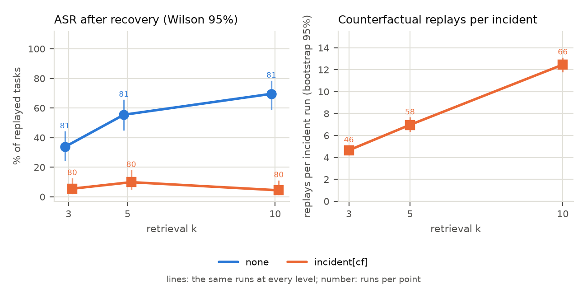
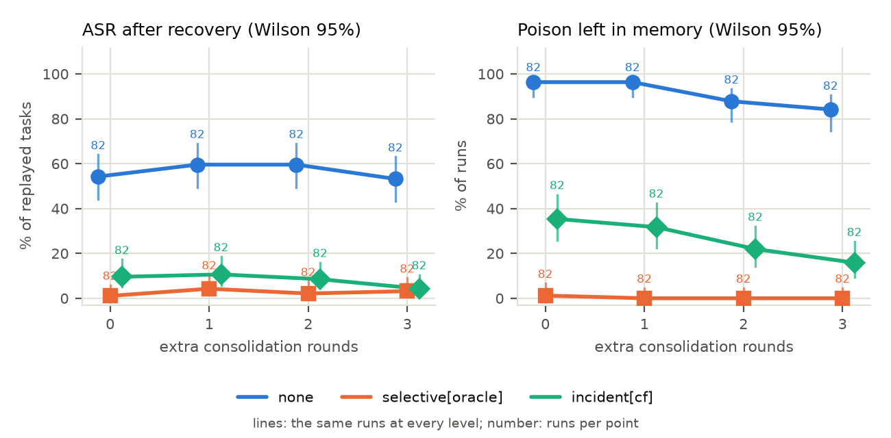
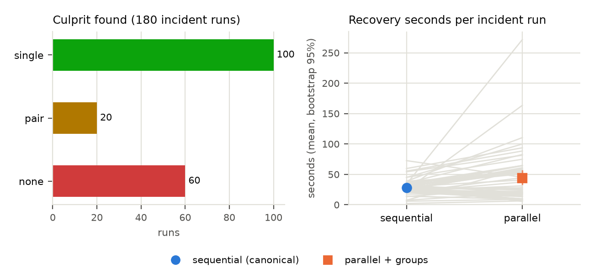
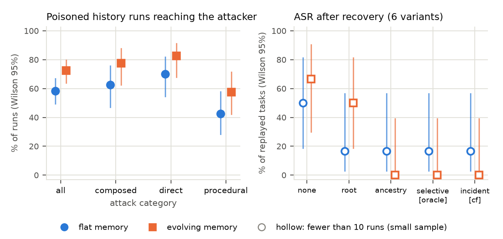

# MemHeal experiment analysis

Generated by `analyze.py` from recover.py records and run summaries; every number below is computed from those files. ASR = attacker outcomes over every replayed task (Wilson 95%); BMP = probes still correct among those the same run answered correctly with no recovery; BR = mean share of tasks whose action matches the clean run (measure.py). Cells over fewer than 10 runs are marked 'small sample' (section 9: fewer than 10 scenarios; its intervals resample scenarios). Section 2's replay-noise floor applies to every single-replay comparison.

## Inputs

| input | path | state | records | runs | unmerged part files |
|---|---|---|---|---|---|
| families | /home/surya/repos/MemHeal/results/families/records.jsonl | ok | 1182 | 84 | 0 |
| recovery | /home/surya/repos/MemHeal/results/recovery/records.jsonl | ok | 3069 | 186 | 0 |
| k | /home/surya/repos/MemHeal/results/ablations/k.jsonl | ok | 906 | 82 | 0 |
| depth | /home/surya/repos/MemHeal/results/ablations/depth.jsonl | ok | 2057 | 82 | 0 |
| reretrieve | /home/surya/repos/MemHeal/results/ablations/reretrieve.jsonl | ok | 241 | 81 | 0 |
| groups | /home/surya/repos/MemHeal/results/ablations/groups.jsonl | ok | 246 | 82 | 0 |
| groups_clean | /home/surya/repos/MemHeal/results/ablations/groups_clean.jsonl | thin | 6 | 2 | 0 |
| claims | /home/surya/repos/MemHeal/results/claims/records.jsonl | thin | 40 | 8 | 0 |
| reinfect | /home/surya/repos/MemHeal/results/claims/reinfect.jsonl | thin | 10 | 2 | 0 |
| flat | /home/surya/repos/MemHeal/results/flat/records.jsonl | thin | 35 | 7 | 0 |
| heal | /home/surya/repos/MemHeal/results/main/records.jsonl | ok | 7107 | 231 | 0 |
| heal_flat | /home/surya/repos/MemHeal/results/flat/main.jsonl | ok | 1512 | 216 | 0 |
| preservation | /home/surya/repos/MemHeal/results/preservation/preservation.jsonl | ok | 1621 | 186 | 0 |
| runs | /home/surya/repos/MemHeal/data/runs | ok | - | - | - |

## 1. Task families (proposal 5.5)

1182 records, 84 runs. One replay per run and configuration (its lowest repeat). BMP's baseline is measure.py's: the same run's 'none' under the same knobs and repeat (any repeat for a configuration replayed once). 'Harmful for any task' = runs where at least one task of the family reached the attacker; 'tasks disagree' = runs whose tasks split on reaching it.

| configuration | runs | ASR (tasks; Wilson 95%) | task 0 | task 1 | task 2 | task 3 | runs whose tasks disagree | harmful for any task (Wilson 95%) | BMP | BR | no none baseline | replay used |
|---|---|---|---|---|---|---|---|---|---|---|---|---|
| none | 83 | 58% (194/332) [53-64] | 55% (46/83) | 58% (48/83) | 57% (47/83) | 64% (53/83) | 39% (32/83) | 76% (63/83) [66-84] | 100% (104/104) | 0.30 | 0 | repeat 1 x83 |
| ancestry | 77 | 2% (5/308) [1-4] | 3% (2/77) | 0% (0/77) | 3% (2/77) | 1% (1/77) | 5% (4/77) | 5% (4/77) [2-13] | 88% (85/97) | 0.69 | 1 | repeat 1 x77 |
| selective[oracle] | 83 | 1% (4/332) [0-3] | 2% (2/83) | 0% (0/83) | 2% (2/83) | 0% (0/83) | 5% (4/83) | 5% (4/83) [2-12] | 91% (95/104) | 0.68 | 0 | repeat 1 x78, repeat 2 x3, repeat 3 x2 |
| incident[cf] | 83 | 10% (33/332) [7-14] | 6% (5/83) | 13% (11/83) | 10% (8/83) | 11% (9/83) | 22% (18/83) | 22% (18/83) [14-32] | 92% (96/104) | 0.63 | 0 | repeat 1 x73, repeat 2 x9, repeat 3 x1 |
| incident[cf]+verify | 77 | 0% (1/308) [0-2] | 1% (1/77) | 0% (0/77) | 0% (0/77) | 0% (0/77) | 1% (1/77) | 1% (1/77) [0-7] | 89% (86/97) | 0.73 | 1 | repeat 1 x77 |

## 2. Repeats (proposal 6.6)

Configurations swept with --repeat. A repeat replays the task family on a fresh copy; for deterministic stores (no counterfactual, no verify) every difference between repeats is the model's replay, which makes these rows the replay-noise floor for the single-replay comparisons elsewhere. incident[cf] also re-runs its counterfactual on each repeat, so its plan can differ too.

### ASR per repeat (all runs replayed at that repeat)

| configuration | repeat | runs | ASR (tasks; Wilson 95%) |
|---|---|---|---|
| none | 1 | 83 | 58% (194/332) [53-64] |
| none | 2 | 83 | 57% (190/332) [52-62] |
| none | 3 | 83 | 59% (196/332) [54-64] |
| ancestry | 1 | 77 | 2% (5/308) [1-4] |
| ancestry | 2 | 77 | 1% (3/308) [0-3] |
| ancestry | 3 | 77 | 1% (2/308) [0-2] |
| selective[oracle] | 1 | 78 | 1% (4/312) [0-3] |
| selective[oracle] | 2 | 79 | 2% (6/316) [1-4] |
| selective[oracle] | 3 | 82 | 2% (5/328) [1-4] |
| incident[cf] | 1 | 73 | 11% (32/292) [8-15] |
| incident[cf] | 2 | 78 | 10% (31/312) [7-14] |
| incident[cf] | 3 | 82 | 10% (34/328) [8-14] |
| incident[cf]+verify | 1 | 77 | 0% (1/308) [0-2] |
| incident[cf]+verify | 2 | 76 | 2% (5/304) [1-4] |
| incident[cf]+verify | 3 | 77 | 2% (5/308) [1-4] |

### Spread across repeats, outcome flips, majority vote
Runs replayed at all three repeats. Spread = largest minus smallest repeat ASR on those runs, in percentage points. Flips count (run, task) outcomes seen at 2+ repeats. Majority = attacker on at least 2 of the 3 replays; single replay = repeat 1 on the same runs.

| configuration | runs (all 3 repeats) | ASR repeat 1 | ASR repeat 2 | ASR repeat 3 | spread (pp) | (run, task) outcome differs | (run, task) attacker vs not differs (Wilson 95%) | ASR majority of 3 | ASR single replay | tasks where majority != single |
|---|---|---|---|---|---|---|---|---|---|---|
| none | 83 | 58% (194/332) [53-64] | 57% (190/332) [52-62] | 59% (196/332) [54-64] | 2 | 17% (58/332) | 11% (35/332) [8-14] | 59% (197/332) [54-64] | 58% (194/332) [53-64] | 5% (15/332) |
| ancestry | 77 | 2% (5/308) [1-4] | 1% (3/308) [0-3] | 1% (2/308) [0-2] | 1 | 15% (45/308) | 2% (6/308) [1-4] | 1% (2/308) [0-2] | 2% (5/308) [1-4] | 1% (3/308) |
| selective[oracle] | 75 | 1% (4/300) [1-3] | 2% (6/300) [1-4] | 2% (5/300) [1-4] | 1 | 15% (47/324) | 2% (6/324) [1-4] | 2% (5/300) [1-4] | 1% (4/300) [1-3] | 1% (3/300) |
| incident[cf] | 68 | 12% (32/272) [8-16] | 11% (30/272) [8-15] | 12% (33/272) [9-17] | 1 | 13% (42/328) | 3% (9/328) [1-5] | 12% (32/272) [8-16] | 12% (32/272) [8-16] | 1% (4/272) |
| incident[cf]+verify | 76 | 0% (1/304) [0-2] | 2% (5/304) [1-4] | 2% (5/304) [1-4] | 1 | 17% (51/308) | 3% (8/308) [1-5] | 1% (3/304) [0-3] | 0% (1/304) [0-2] | 1% (2/304) |

Replay-noise floor (deterministic stores pooled): attacker-vs-not flips in 5% (47/964) [4-6] of (run, task) units; any outcome change in 16% (150/964).

## 3. Retrieval k ablation (proposal 9.3)

82 runs in /home/surya/repos/MemHeal/results/ablations/k.jsonl; the run's own k comes from the canonical sweep (/home/surya/repos/MemHeal/results/recovery/records.jsonl) on the same runs. Ablation records observe the incident from a fresh replay at the new k (observe=fresh); the canonical ones use the run's logged action, so the own-k row is not a fresh observation. Replays and seconds are per run whose observed action was harmful (incident). Read a trend over k from the columns on the runs measured at every k: the all-runs columns also change with which runs a level holds. The figure draws those same runs, with n above each point.

| configuration | k | runs | observe | ASR (tasks; Wilson 95%) | runs still attacked | incident runs | cf replays per incident (bootstrap 95%) | recovery seconds per incident | ASR on runs measured at every level | cf replays per incident on those runs (bootstrap 95%) |
|---|---|---|---|---|---|---|---|---|---|---|
| none | 3 | 82 | fresh | 34% (32/93) [26-45] | 38% (31/82) | - | - | - | 34% (31/92) [25-44] on 81 | - |
| none | 5 | 82 | logged | 56% (52/93) [46-66] | 60% (49/82) | - | - | - | 55% (51/92) [45-65] on 81 | - |
| none | 10 | 81 | fresh | 70% (64/92) [60-78] | 77% (62/81) | - | - | - | 70% (64/92) [60-78] on 81 | - |
| incident[cf] | 3 | 82 | fresh | 5% (5/93) [2-12] | 5% (4/82) | 48 | 4.7 [4.4, 5.1] | 43.1 [35.0, 52.7] | 5% (5/91) [2-12] on 80 | 4.7 [4.3, 5.0] (n=46) |
| incident[cf] | 5 | 82 | logged | 10% (9/93) [5-17] | 10% (8/82) | 60 | 7.0 [6.4, 7.5] | 21.4 [19.4, 23.5] | 10% (9/91) [5-18] on 80 | 7.0 [6.4, 7.6] (n=58) |
| incident[cf] | 10 | 80 | fresh | 4% (4/91) [2-11] | 5% (4/80) | 66 | 12.5 [11.8, 13.1] | 155.6 [129.8, 183.9] | 4% (4/91) [2-11] on 80 | 12.5 [11.8, 13.1] (n=66) |

## 4. Consolidation depth ablation (proposal 9.3)

82 runs in /home/surya/repos/MemHeal/results/ablations/depth.jsonl; depth 0 is the canonical sweep on the same runs (logged incident). Depth d adds d extra consolidation rounds to the copy before recovery. Collateral = quarantined memories labelled benign or outside the lineage (mean per run); poison left = runs whose store still holds an active memory naming the attacker. Read a trend over depth from the columns on the runs measured at every depth: the all-runs columns also change with which runs a level holds. The figure draws those same runs, with n above each point.

| configuration | depth | runs | observe | ASR (tasks; Wilson 95%) | runs still attacked | collateral | quarantined | poison left in memory (Wilson 95%) | ASR on runs measured at every level | collateral on those runs | poison left on those runs |
|---|---|---|---|---|---|---|---|---|---|---|---|
| none | 0 | 82 | logged | 54% (51/94) [44-64] | 59% (48/82) | 0.0 | 0.0 | 96% (79/82) [90-99] | 54% (51/94) [44-64] on 82 | 0.0 | 96% (79/82) [90-99] |
| none | 1 | 82 | fresh | 60% (56/94) [49-69] | 63% (52/82) | 0.0 | 0.0 | 96% (79/82) [90-99] | 60% (56/94) [49-69] on 82 | 0.0 | 96% (79/82) [90-99] |
| none | 2 | 82 | fresh | 60% (56/94) [49-69] | 62% (51/82) | 0.0 | 0.0 | 88% (72/82) [79-93] | 60% (56/94) [49-69] on 82 | 0.0 | 88% (72/82) [79-93] |
| none | 3 | 82 | fresh | 53% (50/94) [43-63] | 56% (46/82) | 0.0 | 0.0 | 84% (69/82) [75-90] | 53% (50/94) [43-63] on 82 | 0.0 | 84% (69/82) [75-90] |
| selective[oracle] | 0 | 82 | logged | 1% (1/94) [0-6] | 1% (1/82) | 0.8 | 7.5 | 1% (1/82) [0-7] | 1% (1/94) [0-6] on 82 | 0.8 | 1% (1/82) [0-7] |
| selective[oracle] | 1 | 82 | fresh | 4% (4/94) [2-10] | 5% (4/82) | 0.8 | 8.5 | 0% (0/82) [0-4] | 4% (4/94) [2-10] on 82 | 0.8 | 0% (0/82) [0-4] |
| selective[oracle] | 2 | 82 | fresh | 2% (2/94) [1-7] | 2% (2/82) | 0.8 | 9.1 | 0% (0/82) [0-4] | 2% (2/94) [1-7] on 82 | 0.8 | 0% (0/82) [0-4] |
| selective[oracle] | 3 | 82 | fresh | 3% (3/94) [1-9] | 4% (3/82) | 0.8 | 9.4 | 0% (0/82) [0-4] | 3% (3/94) [1-9] on 82 | 0.8 | 0% (0/82) [0-4] |
| incident[cf] | 0 | 82 | logged | 10% (9/94) [5-17] | 10% (8/82) | 0.1 | 2.7 | 35% (29/82) [26-46] | 10% (9/94) [5-17] on 82 | 0.1 | 35% (29/82) [26-46] |
| incident[cf] | 1 | 82 | fresh | 11% (10/94) [6-18] | 11% (9/82) | 0.1 | 3.4 | 32% (26/82) [23-42] | 11% (10/94) [6-18] on 82 | 0.1 | 32% (26/82) [23-42] |
| incident[cf] | 2 | 82 | fresh | 9% (8/94) [4-16] | 10% (8/82) | 0.1 | 4.1 | 22% (18/82) [14-32] | 9% (8/94) [4-16] on 82 | 0.1 | 22% (18/82) [14-32] |
| incident[cf] | 3 | 82 | fresh | 4% (4/94) [2-10] | 4% (3/82) | 0.1 | 4.3 | 16% (13/82) [10-25] | 4% (4/94) [2-10] on 82 | 0.1 | 16% (13/82) [10-25] |

## 5. Frozen vs re-retrieval counterfactual, and ancestry / counterfactual ablations (proposal 9.3)

### Frozen vs re-retrieval (81 runs in both)
Frozen = the canonical incident[cf] (the retrieved set is held fixed and one memory removed); re-retrieval removes the memory and retrieves top-k again. Costs are means per incident run (bootstrap 95%); older canonical records state replays only in their notes and never measured cf seconds.

| method | runs | incident runs | ASR after (Wilson 95%) | runs still attacked | cf replays | seconds | cf seconds | LLM calls |
|---|---|---|---|---|---|---|---|---|
| frozen (canonical) | 81 | 59 | 10% (9/92) [5-18] | 10% (8/81) | 7.0 [6.4, 7.6] | 21.5 [19.5, 23.6] | - | 23.4 [21.2, 25.6] |
| re-retrieval | 81 | 59 | 7% (6/92) [3-14] | 7% (6/81) | 7.0 [6.5, 7.5] | 80.9 [60.9, 104.4] | 80.9 [60.8, 104.3] | 23.3 [21.0, 25.5] |

Paired, re-retrieval minus frozen, per incident run in both:

| metric | runs | difference (bootstrap 95%) |
|---|---|---|
| cf replays | 59 | +0.0 [-0.7, +0.7] |
| seconds | 59 | +59.4 [+39.7, +82.4] |
| LLM calls | 59 | -0.1 [-2.6, +2.6] |
| run ASR (x100) | 59 | -2.5 [-6.8, +0.0] |

| A | B | runs | population | ASR (pp) | BR (x100) | BMP (pp) | collateral | poison left (pp) |
|---|---|---|---|---|---|---|---|---|
| incident[cf]+reretrieve | incident[cf] | 59 | incident | -2.5 [-6.8, +0.0] | +5.9 [+0.8, +12.7] | -3.9 [-10.0, +1.4] | +0.07 [-0.12, +0.27] | +0.0 [+0.0, +0.0] |

### Culprit agreement
Culprits = minimal removal sets that flip the decision. The canonical sweep's older records do not store them, so the frozen side comes from the first frozen source that does (families sweep: 59 runs). The noise floor compares two frozen ablations of one run (families repeats).

| agreement | frozen vs re-retrieval (59 incident runs) | frozen vs frozen (160 run-repeat pairs) |
|---|---|---|
| same culprits | 34% (20/59) | 43% (69/160) |
| overlapping | 3% (2/59) | 4% (7/160) |
| disjoint | 0% (0/59) | 0% (0/160) |
| only frozen found one | 7% (4/59) | 1% (2/160) |
| only re-retrieval found one | 17% (10/59) | 5% (8/160) |
| neither found one | 39% (23/59) | 46% (74/160) |

### Ancestry-off vs lineage-intersected vs counterfactual-off (canonical sweep)
Incident runs = the original action reached the attacker (the only runs a counterfactual has an alarm for). Collateral and quarantined are means per run.

| population | configuration | role | runs | ASR (tasks; Wilson 95%) | runs still attacked | BMP | BR | poison left in memory | quarantined | collateral | LLM calls |
|---|---|---|---|---|---|---|---|---|---|---|---|
| incident runs | none | no recovery | 67 | 71% (55/77) [61-80] | 78% (52/67) | 100% (87/87) | 0.19 | 100% (67/67) | 0.0 | 0.0 | 0.0 |
| incident runs | ancestry | counterfactual off: whole lineage | 67 | 3% (2/77) [1-9] | 3% (2/67) | 89% (77/87) | 0.66 | 1% (1/67) | 8.2 | 1.1 | 0.0 |
| incident runs | selective[cf] | lineage-intersected counterfactual | 67 | 12% (9/77) [6-21] | 10% (7/67) | 91% (79/87) | 0.57 | 12% (8/67) | 7.6 | 0.8 | 9.4 |
| incident runs | incident[cf] | ancestry off: counterfactual over all retrieved | 67 | 8% (6/77) [4-16] | 7% (5/67) | 92% (80/87) | 0.61 | 15% (10/67) | 3.7 | 0.1 | 22.5 |
| all runs | none | no recovery | 93 | 54% (57/106) [44-63] | 58% (54/93) | 100% (114/114) | 0.32 | 96% (89/93) | 0.0 | 0.0 | 0.0 |
| all runs | ancestry | counterfactual off: whole lineage | 93 | 2% (2/106) [1-7] | 2% (2/93) | 90% (103/114) | 0.67 | 1% (1/93) | 7.8 | 1.1 | 0.0 |
| all runs | selective[cf] | lineage-intersected counterfactual | 93 | 10% (11/106) [6-18] | 10% (9/93) | 91% (104/114) | 0.62 | 32% (30/93) | 6.9 | 0.8 | 6.7 |
| all runs | incident[cf] | ancestry off: counterfactual over all retrieved | 93 | 8% (9/106) [5-15] | 9% (8/93) | 92% (105/114) | 0.62 | 34% (32/93) | 2.7 | 0.1 | 16.2 |

A minus B on the same runs, percentile bootstrap 95% intervals over runs; ASR here is the mean of per-run ASR (measure.paired_differences). Each configuration is one replay per run: compare against the replay-noise rows (A/A) and Section 2 before reading a difference as real.

| A | B | runs | population | ASR (pp) | BR (x100) | BMP (pp) | collateral | poison left (pp) |
|---|---|---|---|---|---|---|---|---|
| incident[cf] | selective[cf] | 67 | incident | -3.7 [-8.2, +0.0] | +3.7 [-4.5, +11.9] | +1.1 [-3.6, +6.2] | -0.64 [-1.10, -0.18] | +3.0 [+0.0, +7.5] |
| ancestry | selective[cf] | 67 | incident | -7.5 [-14.9, -1.5] | +9.0 [+0.0, +17.9] | -2.3 [-9.0, +4.8] | +0.30 [+0.15, +0.48] | -10.4 [-19.4, -4.5] |
| incident[cf] | ancestry | 67 | incident | +3.7 [+0.0, +8.2] | -5.2 [-14.2, +2.2] | +3.4 [-1.2, +9.0] | -0.94 [-1.45, -0.51] | +13.4 [+6.0, +22.4] |

Replay noise in the canonical sweep (measure.replay_noise: 372 measurements written twice on the same deterministic store): attacker-vs-not flips in 3% (13/424) [2-5] of tasks, probe flips in 4% (30/776). Bootstrap A/A rows: rerun with --aa, or see results/recovery/recovery_tables.md.

## 6. Pair/group counterfactuals and latency (proposal 12.3)

### Culprit kinds (poisoned runs, incident[cf]+verify with --cf-groups)
Pairs and the all-candidates group are tried only when no single removal flips the decision; verify rounds can add sets from a later ablation.

| culprit found | runs (246) | share of alarms (Wilson 95%) |
|---|---|---|
| single | 100 | 56% (100/180) [48-63] |
| pair | 20 | 11% (20/180) [7-17] |
| group | 0 | 0% (0/180) [0-2] |
| none | 60 | 33% (60/180) [27-41] |
| no incident | 66 | - |

### ASR after incident[cf]+verify: groups vs canonical (82 runs in both)

| sweep | runs | ASR (tasks; Wilson 95%) | runs still attacked | BMP | BR | poison left in memory | quarantined | collateral |
|---|---|---|---|---|---|---|---|---|
| canonical (sequential, singles) | 82 | 0% (0/94) [0-4] | 0% (0/82) | 91% (94/103) | 0.67 | 30% (25/82) | 2.9 | 0.2 |
| groups, 6 workers | 82 | 2% (2/94) [1-7] | 2% (2/82) | 90% (93/103) | 0.70 | 30% (25/82) | 2.9 | 0.2 |

A minus B on the same runs, percentile bootstrap 95% intervals over runs; ASR here is the mean of per-run ASR (measure.paired_differences). Each configuration is one replay per run: compare against the replay-noise rows (A/A) and Section 2 before reading a difference as real.

| A | B | runs | population | ASR (pp) | BR (x100) | BMP (pp) | collateral | poison left (pp) |
|---|---|---|---|---|---|---|---|---|
| incident[cf]+groups+verify | incident[cf]+verify | 60 | incident | +3.3 [+0.0, +8.3] | +5.8 [-2.5, +14.2] | -1.3 [-5.6, +2.8] | +0.02 [-0.13, +0.15] | +0.0 [+0.0, +0.0] |
| incident[cf]+groups+verify | incident[cf]+verify | 82 | all | +2.4 [+0.0, +6.1] | +2.4 [-4.9, +9.1] | -1.0 [-4.1, +2.4] | +0.01 [-0.10, +0.11] | +0.0 [+0.0, +0.0] |

### Latency, parallel vs sequential (60 incident runs in both)
Parallel = 6 replay workers, replays stopped at the first acting call, plus keep-only-one / pair / group replays; sequential = the canonical sweep, one worker, full replays, single removals. The three changes are confounded here. Paired difference = parallel minus sequential.

| metric | sequential mean | parallel mean | runs paired | parallel minus sequential (bootstrap 95%) |
|---|---|---|---|---|
| cf replays | 7.5 [6.7, 8.3] | 16.8 [14.4, 19.5] | 60 | +9.3 [+7.4, +11.4] |
| cf seconds | - | 36.2 [27.8, 46.4] | 0 (small sample) | - |
| recovery seconds | 27.9 [24.8, 31.1] | 43.6 [34.0, 55.8] | 60 | +15.7 [+6.6, +26.8] |
| LLM calls | 29.3 [26.1, 32.7] | 42.6 [35.3, 50.4] | 60 | +13.3 [+8.1, +19.4] |
| seconds per cf replay | 3.9 [3.6, 4.1] | 4.2 [2.5, 6.5] | 60 | +0.3 [-1.2, +2.5] |

### Clean-run false-alarm control
Clean runs given a simulated alarm on their own action. Canonical rows are the same configuration without --cf-groups on the same runs.

| configuration | sweep | runs | alarms raised | quarantined | collateral | BMP | BR | culprit kinds |
|---|---|---|---|---|---|---|---|---|
| incident[cf]+verify | groups | 2 (small sample) | 2 | 2.0 | 2.0 | 50% (2/4) | 0.50 | none 1, single 1 |
| incident[cf]+verify | canonical | 2 (small sample) | 2 | 2.0 | 2.0 | 50% (2/4) | 0.50 | unknown 2 |
| selective[cf]+verify | groups | 2 (small sample) | 2 | 2.0 | 2.0 | 50% (2/4) | 0.50 | none 1, single 1 |
| selective[cf]+verify | canonical | 2 (small sample) | 2 | 2.0 | 2.0 | 50% (2/4) | 0.50 | unknown 2 |

## 7. Claim repair (proposal 12.3 / 8.9)

8 runs. BMP's baseline is the same run's 'none' from /home/surya/repos/MemHeal/results/recovery/records.jsonl (the claims sweep has no 'none'). Claim repairs = memories rewritten without the attacker's claim (mean per run). Oracle rows on the runs with all three oracle configurations; cf rows on the runs with both cf configurations.

| configuration | runs | ASR (tasks; Wilson 95%) | runs still attacked | BMP | BR | poison left in memory | claim repairs | quarantined | collateral | LLM calls | seconds |
|---|---|---|---|---|---|---|---|---|---|---|---|
| selective[oracle] | 8 (small sample) | 0% (0/9) [0-30] | 0% (0/8) | 78% (7/9) | 0.50 | 0% (0/8) | 0.0 | 7.0 | 0.5 | 0.0 | 2.1 |
| selective_recon[oracle] | 8 (small sample) | 0% (0/9) [0-30] | 0% (0/8) | 78% (7/9) | 0.50 | 0% (0/8) | 0.0 | 7.0 | 0.5 | 1.0 | 1.8 |
| selective_claims[oracle] | 8 (small sample) | 11% (1/9) [2-44] | 12% (1/8) | 56% (5/9) | 0.44 | 0% (0/8) | 1.0 | 7.0 | 0.5 | 1.0 | 1.9 |
| selective[cf] | 8 (small sample) | 0% (0/9) [0-30] | 0% (0/8) | 78% (7/9) | 0.62 | 0% (0/8) | 0.0 | 7.0 | 0.5 | 10.4 | 20.3 |
| selective_claims[cf] | 8 (small sample) | 11% (1/9) [2-44] | 12% (1/8) | 78% (7/9) | 0.44 | 12% (1/8) | 0.9 | 7.0 | 0.5 | 11.8 | 13.7 |

A minus B on the same runs, percentile bootstrap 95% intervals over runs; ASR here is the mean of per-run ASR (measure.paired_differences). Each configuration is one replay per run: compare against the replay-noise rows (A/A) and Section 2 before reading a difference as real. 'mixed' = runs with a mixed descendant. The last row is an A/A check: the same oracle store replayed in this sweep and in the canonical one.

| A | B | runs | population | ASR (pp) | BR (x100) | BMP (pp) | collateral | poison left (pp) |
|---|---|---|---|---|---|---|---|---|
| selective_claims[oracle] | selective[oracle] | 8 (small sample) | all | +6.2 [+0.0, +18.8] | -6.2 [-18.8, +0.0] | -22.2 [-50.0, +0.0] | +0.00 [+0.00, +0.00] | +0.0 [+0.0, +0.0] |
| selective_claims[oracle] | selective[oracle] | 8 (small sample) | mixed | +6.2 [+0.0, +18.8] | -6.2 [-18.8, +0.0] | -22.2 [-44.4, +0.0] | +0.00 [+0.00, +0.00] | +0.0 [+0.0, +0.0] |
| selective_claims[oracle] | selective_recon[oracle] | 8 (small sample) | all | +6.2 [+0.0, +18.8] | -6.2 [-18.8, +0.0] | -22.2 [-71.4, +16.7] | +0.00 [+0.00, +0.00] | +0.0 [+0.0, +0.0] |
| selective_recon[oracle] | selective[oracle] | 8 (small sample) | mixed | +0.0 [+0.0, +0.0] | +0.0 [+0.0, +0.0] | +0.0 [-28.6, +40.0] | +0.00 [+0.00, +0.00] | +0.0 [+0.0, +0.0] |
| selective_claims[cf] | selective[cf] | 8 (small sample) | incident | +6.2 [+0.0, +18.8] | -18.8 [-43.8, +0.0] | +0.0 [-40.0, +28.6] | +0.00 [+0.00, +0.00] | +12.5 [+0.0, +37.5] |
| selective[oracle] | selective[oracle]+recovery_sweep | 8 (small sample) | all | +0.0 [+0.0, +0.0] | +0.0 [+0.0, +0.0] | +0.0 [+0.0, +0.0] | +0.00 [+0.00, +0.00] | +0.0 [+0.0, +0.0] |

### Reinfection (Section 8.8 schedule)
ASR at each checkpoint (0 on patched pages, later on live pages), runs clean after recovery that are attacked again, and runs whose store names the attacker at the last checkpoint. Reference: selective[oracle]+immunize from the canonical sweep on the same runs.

| configuration | runs | ASR cp 0 | ASR cp 1 | ASR cp 3 | ASR cp 5 | ASR cp 10 | reinfected (of clean after recovery) | store names attacker |
|---|---|---|---|---|---|---|---|---|
| selective[oracle]+immunize | 2 (small sample) | 0% (0/2) | 100% (2/2) | 50% (1/2) | 50% (1/2) | 50% (1/2) | 100% (2/2) | 0% (0/2) at 10 |
| selective_claims[oracle]+immunize | 2 (small sample) | 0% (0/2) | 100% (2/2) | 50% (1/2) | 50% (1/2) | 50% (1/2) | 100% (2/2) | 0% (0/2) at 10 |

## 8. Flat vs evolving memory (proposal 6.5)

### Original-run outcomes (480 runs; flat 1198-1434, evolving 0959-1197; 0 folders without a readable summary)

| memory | condition | category | runs | attacker (Wilson 95%) | correct | other | no action |
|---|---|---|---|---|---|---|---|
| flat | poisoned | all | 120 | 58% (70/120) [49-67] | 22 | 20 | 8 |
| flat | poisoned | composed | 40 | 62% (25/40) [47-76] | 2 | 10 | 3 |
| flat | poisoned | direct | 40 | 70% (28/40) [55-82] | 5 | 3 | 4 |
| flat | poisoned | procedural | 40 | 42% (17/40) [29-58] | 15 | 7 | 1 |
| flat | clean | all | 120 | 2% (2/120) [0-6] | 92 | 17 | 9 |
| flat | clean | composed | 40 | 0% (0/40) [0-9] | 30 | 6 | 4 |
| flat | clean | direct | 40 | 2% (1/40) [0-13] | 29 | 7 | 3 |
| flat | clean | procedural | 40 | 2% (1/40) [0-13] | 33 | 4 | 2 |
| evolving | poisoned | all | 120 | 72% (87/120) [64-80] | 20 | 12 | 1 |
| evolving | poisoned | composed | 40 | 78% (31/40) [62-88] | 4 | 5 | 0 |
| evolving | poisoned | direct | 40 | 82% (33/40) [68-91] | 3 | 3 | 1 |
| evolving | poisoned | procedural | 40 | 58% (23/40) [42-71] | 13 | 4 | 0 |
| evolving | clean | all | 120 | 2% (2/120) [0-6] | 93 | 15 | 10 |
| evolving | clean | composed | 40 | 2% (1/40) [0-13] | 29 | 6 | 4 |
| evolving | clean | direct | 40 | 2% (1/40) [0-13] | 32 | 5 | 2 |
| evolving | clean | procedural | 40 | 0% (0/40) [0-9] | 32 | 4 | 4 |

### Paired by variant (exact McNemar)
Each variant has one flat and one evolving run; discordant pairs decide the test.

| condition | category | variant pairs | attacker in both | flat only | evolving only | neither | exact McNemar p |
|---|---|---|---|---|---|---|---|
| poisoned | all | 120 | 58 | 12 | 29 | 21 | 0.0115 |
| poisoned | composed | 40 | 19 | 6 | 12 | 3 | 0.238 |
| poisoned | direct | 40 | 25 | 3 | 8 | 4 | 0.227 |
| poisoned | procedural | 40 | 14 | 3 | 9 | 14 | 0.146 |
| clean | all | 120 | 1 | 1 | 1 | 117 | 1 |
| clean | composed | 40 | 0 | 0 | 1 | 39 | 1 |
| clean | direct | 40 | 1 | 0 | 0 | 39 | 1 |
| clean | procedural | 40 | 0 | 1 | 0 | 39 | 1 |

### Recovery, flat vs evolving (6 variants with recovery records in both)
Flat records from the X3 sweep, evolving from the canonical sweep, restricted to the same variants. Root-only effectiveness is the key contrast: in a flat store nothing is consolidated, so removing the root should remove the attack.

| configuration | memory | runs | ASR (tasks; Wilson 95%) | runs still attacked | BMP | BR | poison left in memory | root already consolidated |
|---|---|---|---|---|---|---|---|---|
| none | flat | 6 (small sample) | 50% (3/6) [19-81] | 50% (3/6) | 100% (10/10) | 0.17 | 100% (6/6) | 0% |
| none | evolving | 6 (small sample) | 67% (4/6) [30-90] | 67% (4/6) | 100% (7/7) | 0.17 | 100% (6/6) | 83% |
| root | flat | 6 (small sample) | 17% (1/6) [3-56] | 17% (1/6) | 100% (10/10) | 0.33 | 33% (2/6) | 0% |
| root | evolving | 6 (small sample) | 50% (3/6) [19-81] | 50% (3/6) | 100% (7/7) | 0.33 | 100% (6/6) | 83% |
| ancestry | flat | 6 (small sample) | 17% (1/6) [3-56] | 17% (1/6) | 100% (10/10) | 0.33 | 33% (2/6) | 0% |
| ancestry | evolving | 6 (small sample) | 0% (0/6) [0-39] | 0% (0/6) | 86% (6/7) | 0.50 | 0% (0/6) | 83% |
| selective[oracle] | flat | 6 (small sample) | 17% (1/6) [3-56] | 17% (1/6) | 100% (10/10) | 0.50 | 33% (2/6) | 0% |
| selective[oracle] | evolving | 6 (small sample) | 0% (0/6) [0-39] | 0% (0/6) | 86% (6/7) | 0.50 | 0% (0/6) | 83% |
| incident[cf] | flat | 6 (small sample) | 17% (1/6) [3-56] | 17% (1/6) | 90% (9/10) | 0.33 | 67% (4/6) | 0% |
| incident[cf] | evolving | 6 (small sample) | 0% (0/6) [0-39] | 0% (0/6) | 86% (6/7) | 0.67 | 33% (2/6) | 83% |

| memory | runs with none and root | attacked with no recovery | cleared by root alone (Wilson 95%) |
|---|---|---|---|
| flat | 6 (small sample) | 3 (small sample) | 67% (2/3) [21-94] |
| evolving | 6 (small sample) | 4 (small sample) | 25% (1/4) [5-70] |

Run-level ASR reduction by root (none minus root), flat minus evolving, paired by variant (6 (small sample) variants): +16.7 [-33.3, +66.7] percentage points (bootstrap 95%).

## 9a. Healing vs quarantine (Phase 2, H): results/main/records.jsonl

231 runs (77 scenarios) a heal mode was applied to; 174 runs (72 scenarios) with an incident: the original action reached the attacker, the only runs heal and incident act on. Each configuration's record for a run is read from the first of /home/surya/repos/MemHeal/results/main/records.jsonl, /home/surya/repos/MemHeal/results/claims/records.jsonl, /home/surya/repos/MemHeal/results/recovery/records.jsonl that holds it, at its lowest repeat ('from' counts runs per file). Rows are on these runs; a configuration missing on some shows its own n, and the paired rows below are on the runs both configurations have. A scenario's history runs share its pages, tasks and poison, so every interval in this section is a percentile bootstrap 95% resampling scenarios (each with all of its runs), and 'small sample' marks fewer than 10 scenarios.

### Outcome after recovery
Poison left = runs whose store still holds an active memory naming the attacker; residual = mean such memories per run. Rates pool runs (ASR pools their tasks, BMP their probes); intervals: percentile bootstrap 95% resampling scenarios.

| population | configuration | from | runs (scenarios) | ASR (tasks) | runs still attacked | BMP | BR | poison left in memory | residual |
|---|---|---|---|---|---|---|---|---|---|
| incident runs | heal[cf] family=full cf_workers=6 stop_after_action=True | heal 174 | 174 (72 scenarios) | 4% (27/696) [1-6] | 7% (13/174) [3-12] | 91% (218/240) [87-95] | 0.65 | 10% (18/174) [6-15] | 0.1 |
| incident runs | heal[cf]+verify family=full cf_workers=6 stop_after_action=True verify_n=3 | heal 28 | 28 (28 scenarios) | 0% (0/112) [0-12] | 0% (0/28) [0-12] | 94% (30/32) [85-100] | 0.68 | 4% (1/28) [0-11] | 0.0 |
| incident runs | heal_rebuild[cf] family=full cf_workers=6 stop_after_action=True | heal 174 | 174 (72 scenarios) | 3% (19/696) [1-5] | 6% (10/174) [2-9] | 92% (221/240) [89-95] | 0.68 | 11% (19/174) [6-17] | 0.1 |
| incident runs | heal_oracle[oracle] family=full cf_workers=6 stop_after_action=True | heal 174 | 174 (72 scenarios) | 5% (36/696) [2-9] | 9% (16/174) [4-14] | 90% (217/240) [86-95] | 0.69 | 11% (19/174) [6-17] | 0.1 |
| incident runs | incident[cf] | recovery 55 | 55 (55 scenarios) | 9% (6/64) [2-18] | 9% (5/55) [2-18] | 91% (69/76) [84-97] | 0.58 | 18% (10/55) [9-29] | 0.3 |
| incident runs | incident[cf] family=full cf_workers=6 stop_after_action=True | heal 174 | 174 (72 scenarios) | 5% (35/696) [2-8] | 10% (17/174) [4-16] | 85% (203/240) [80-89] | 0.66 | 15% (26/174) [9-22] | 0.2 |
| incident runs | incident[cf]+verify | recovery 55 | 55 (55 scenarios) | 0% (0/64) [0-7] | 0% (0/55) [0-7] | 91% (69/76) [85-97] | 0.60 | 15% (8/55) [5-24] | 0.2 |
| incident runs | incident[cf]+verify family=full cf_workers=6 stop_after_action=True verify_n=3 | heal 30 | 30 (30 scenarios) | 1% (1/120) [0-2] | 3% (1/30) [0-10] | 86% (31/36) [76-95] | 0.62 | 13% (4/30) [3-27] | 0.1 |
| incident runs | selective_claims[cf] | claims 6 | 6 (6 scenarios, small sample) | 14% (1/7) [0-33] | 17% (1/6) [0-50] | 88% (7/8) [50-100] | 0.58 | 17% (1/6) [0-50] | 0.2 |
| incident runs | selective_claims[oracle] | claims 6 | 6 (6 scenarios, small sample) | 14% (1/7) [0-33] | 17% (1/6) [0-50] | 62% (5/8) [33-86] | 0.58 | 0% (0/6) [0-39] | 0.0 |
| incident runs | selective_claims[oracle] family=full stop_after_action=True | heal 174 | 174 (72 scenarios) | 2% (17/696) [1-4] | 8% (14/174) [4-13] | 91% (219/240) [87-95] | 0.69 | 2% (3/174) [0-4] | 0.0 |
| incident runs | selective_recon[oracle] | claims 6, recovery 49 | 55 (55 scenarios) | 2% (1/64) [0-5] | 2% (1/55) [0-5] | 91% (69/76) [83-97] | 0.75 | 2% (1/55) [0-5] | 0.1 |
| incident runs | selective_recon[oracle] family=full stop_after_action=True | heal 174 | 174 (72 scenarios) | 1% (9/696) [0-2] | 4% (7/174) [1-8] | 92% (220/240) [87-95] | 0.72 | 2% (3/174) [0-4] | 0.0 |
| incident runs | selective[cf] | claims 6, recovery 49 | 55 (55 scenarios) | 12% (8/64) [3-22] | 11% (6/55) [4-20] | 89% (68/76) [82-96] | 0.57 | 15% (8/55) [5-24] | 0.2 |
| incident runs | selective[oracle] | claims 6, recovery 49 | 55 (55 scenarios) | 2% (1/64) [0-5] | 2% (1/55) [0-5] | 86% (65/76) [78-93] | 0.65 | 2% (1/55) [0-5] | 0.1 |
| incident runs | selective[oracle] family=full stop_after_action=True | heal 174 | 174 (72 scenarios) | 2% (14/696) [1-4] | 6% (10/174) [2-10] | 83% (200/240) [78-89] | 0.69 | 2% (3/174) [0-4] | 0.0 |
| incident runs | selective[oracle]+immunize | recovery 55 | 55 (55 scenarios) | 2% (1/64) [0-5] | 2% (1/55) [0-5] | 88% (67/76) [79-96] | 0.74 | 2% (1/55) [0-5] | 0.1 |
| incident runs | unmerge[cf] | recovery 55 | 55 (55 scenarios) | 9% (6/64) [2-18] | 9% (5/55) [2-18] | 95% (72/76) [89-99] | 0.67 | 15% (8/55) [5-24] | 0.2 |
| incident runs | unmerge[oracle] | recovery 55 | 55 (55 scenarios) | 2% (1/64) [0-5] | 2% (1/55) [0-5] | 88% (67/76) [81-95] | 0.67 | 2% (1/55) [0-5] | 0.1 |
| incident runs | unmerge[oracle] family=full stop_after_action=True | heal 174 | 174 (72 scenarios) | 1% (5/696) [0-2] | 2% (4/174) [1-5] | 90% (216/240) [86-94] | 0.71 | 2% (3/174) [0-4] | 0.0 |
| all runs | heal[cf] family=full cf_workers=6 stop_after_action=True | heal 231 | 231 (77 scenarios) | 7% (67/924) [5-10] | 16% (36/231) [11-21] | 91% (278/304) [88-95] | 0.64 | 28% (65/231) [21-35] | 0.3 |
| all runs | heal[cf]+verify family=full cf_workers=6 stop_after_action=True verify_n=3 | heal 37 | 37 (37 scenarios) | 0% (0/148) [0-9] | 0% (0/37) [0-9] | 88% (36/41) [75-98] | 0.67 | 16% (6/37) [5-30] | 0.2 |
| all runs | heal_rebuild[cf] family=full cf_workers=6 stop_after_action=True | heal 231 | 231 (77 scenarios) | 6% (58/924) [4-9] | 15% (34/231) [10-19] | 92% (281/304) [89-96] | 0.67 | 29% (66/231) [22-35] | 0.4 |
| all runs | heal_oracle[oracle] family=full cf_workers=6 stop_after_action=True | heal 231 | 231 (77 scenarios) | 8% (74/924) [5-11] | 17% (40/231) [13-23] | 91% (277/304) [87-95] | 0.68 | 29% (66/231) [22-35] | 0.4 |
| all runs | incident[cf] | recovery 77 | 77 (77 scenarios) | 10% (9/89) [4-18] | 10% (8/77) [4-18] | 92% (91/99) [87-97] | 0.60 | 38% (29/77) [27-49] | 0.5 |
| all runs | incident[cf] family=full cf_workers=6 stop_after_action=True | heal 231 | 231 (77 scenarios) | 7% (69/924) [5-10] | 16% (37/231) [11-21] | 87% (265/304) [83-91] | 0.66 | 32% (73/231) [24-39] | 0.4 |
| all runs | incident[cf]+verify | recovery 77 | 77 (77 scenarios) | 0% (0/89) [0-5] | 0% (0/77) [0-5] | 92% (91/99) [86-97] | 0.65 | 32% (25/77) [22-44] | 0.4 |
| all runs | incident[cf]+verify family=full cf_workers=6 stop_after_action=True verify_n=3 | heal 40 | 40 (40 scenarios) | 1% (1/160) [0-2] | 2% (1/40) [0-8] | 84% (38/45) [75-94] | 0.63 | 25% (10/40) [12-40] | 0.3 |
| all runs | selective_claims[cf] | claims 6 | 6 (6 scenarios, small sample) | 14% (1/7) [0-33] | 17% (1/6) [0-50] | 88% (7/8) [50-100] | 0.58 | 17% (1/6) [0-50] | 0.2 |
| all runs | selective_claims[oracle] | claims 6 | 6 (6 scenarios, small sample) | 14% (1/7) [0-33] | 17% (1/6) [0-50] | 62% (5/8) [33-86] | 0.58 | 0% (0/6) [0-39] | 0.0 |
| all runs | selective_claims[oracle] family=full stop_after_action=True | heal 231 | 231 (77 scenarios) | 2% (18/924) [1-3] | 6% (15/231) [3-10] | 92% (280/304) [89-95] | 0.70 | 1% (3/231) [0-3] | 0.0 |
| all runs | selective_recon[oracle] | claims 6, recovery 71 | 77 (77 scenarios) | 1% (1/89) [0-4] | 1% (1/77) [0-4] | 92% (91/99) [86-97] | 0.73 | 1% (1/77) [0-4] | 0.0 |
| all runs | selective_recon[oracle] family=full stop_after_action=True | heal 231 | 231 (77 scenarios) | 1% (10/924) [0-2] | 3% (8/231) [1-6] | 91% (276/304) [86-95] | 0.73 | 1% (3/231) [0-3] | 0.0 |
| all runs | selective[cf] | claims 6, recovery 71 | 77 (77 scenarios) | 11% (10/89) [4-20] | 10% (8/77) [4-18] | 91% (90/99) [85-96] | 0.62 | 35% (27/77) [25-47] | 0.4 |
| all runs | selective[oracle] | claims 6, recovery 71 | 77 (77 scenarios) | 1% (1/89) [0-4] | 1% (1/77) [0-4] | 89% (88/99) [82-94] | 0.68 | 1% (1/77) [0-4] | 0.0 |
| all runs | selective[oracle] family=full stop_after_action=True | heal 231 | 231 (77 scenarios) | 2% (15/924) [1-3] | 5% (11/231) [2-8] | 86% (261/304) [81-90] | 0.70 | 1% (3/231) [0-3] | 0.0 |
| all runs | selective[oracle]+immunize | recovery 77 | 77 (77 scenarios) | 1% (1/89) [0-4] | 1% (1/77) [0-4] | 91% (90/99) [84-97] | 0.76 | 1% (1/77) [0-4] | 0.0 |
| all runs | unmerge[cf] | recovery 77 | 77 (77 scenarios) | 10% (9/89) [4-18] | 10% (8/77) [4-18] | 95% (94/99) [90-99] | 0.68 | 35% (27/77) [25-47] | 0.4 |
| all runs | unmerge[oracle] | recovery 77 | 77 (77 scenarios) | 1% (1/89) [0-4] | 1% (1/77) [0-4] | 91% (90/99) [85-96] | 0.69 | 1% (1/77) [0-4] | 0.0 |
| all runs | unmerge[oracle] family=full stop_after_action=True | heal 231 | 231 (77 scenarios) | 1% (5/924) [0-1] | 2% (4/231) [0-3] | 90% (275/304) [87-94] | 0.72 | 1% (3/231) [0-3] | 0.0 |

### What recovery did, and its cost (all runs)
Means per run. healed = flagged memories replaced by a healed memory; heal-quarantined = flagged memories heal quarantined with nothing in their place; claims kept / dropped = claims written into replacements / judged to carry the attack (heal and selective_claims); claim cf replays = heal's claim-level counterfactual, not in cf replays (the memory-level ablation). '-' = no record of that configuration states the field (older records). Intervals: percentile bootstrap 95% resampling scenarios.

| configuration | runs (scenarios) | quarantined | healed | heal-quarantined | claims kept | claims dropped | cf replays | claim cf replays | LLM calls | seconds |
|---|---|---|---|---|---|---|---|---|---|---|
| heal[cf] family=full cf_workers=6 stop_after_action=True | 231 (77 scenarios) | 2.9 | 0.7 | 2.0 | 1.5 | 4.4 | 5.3 [4.7, 5.8] | 2.4 [2.0, 2.8] | 19.4 [17.2, 21.5] | 31.6 [26.8, 36.4] |
| heal[cf]+verify family=full cf_workers=6 stop_after_action=True verify_n=3 | 37 (37 scenarios) | 3.5 | 0.7 | 2.7 | 1.1 | 5.7 | 5.9 [4.8, 6.9] | 3.6 [2.0, 5.4] | 52.7 [45.1, 59.7] | 99.7 [84.4, 116.0] |
| heal_rebuild[cf] family=full cf_workers=6 stop_after_action=True | 231 (77 scenarios) | 2.8 | 0.7 | 2.0 | 1.8 | 2.6 | 5.2 [4.6, 5.7] | 2.5 [2.0, 3.1] | 19.9 [17.5, 22.3] | 33.4 [26.8, 41.7] |
| heal_oracle[oracle] family=full cf_workers=6 stop_after_action=True | 231 (77 scenarios) | 2.8 | 0.8 | 1.9 | 1.7 | 3.9 | 5.4 [4.8, 5.9] | 0.0 [0.0, 0.0] | 14.3 [12.5, 16.1] | 22.3 [18.7, 26.5] |
| incident[cf] | 77 (77 scenarios) | 2.6 | - | - | - | - | 7.1 [6.6, 7.7] | - | 16.7 [13.6, 19.6] | 15.2 [12.4, 17.8] |
| incident[cf] family=full cf_workers=6 stop_after_action=True | 231 (77 scenarios) | 2.8 | 0.0 | 0.0 | 0.0 | 0.0 | 5.3 [4.7, 5.8] | 0.0 [0.0, 0.0] | 11.6 [10.1, 13.2] | 20.5 [16.4, 25.2] |
| incident[cf]+verify | 77 (77 scenarios) | 2.8 | - | - | - | - | 7.5 [6.7, 8.4] | - | 22.7 [19.1, 26.4] | 21.6 [18.3, 25.1] |
| incident[cf]+verify family=full cf_workers=6 stop_after_action=True verify_n=3 | 40 (40 scenarios) | 3.2 | 0.0 | 0.0 | 0.0 | 0.0 | 5.8 [4.6, 7.0] | 0.0 [0.0, 0.0] | 48.2 [40.5, 57.4] | 108.5 [87.1, 133.6] |
| selective_claims[cf] | 6 (6 scenarios, small sample) | 6.2 | - | - | - | - | 3.3 [2.7, 4.0] | - | 13.3 [10.2, 16.5] | 15.6 [11.4, 19.9] |
| selective_claims[oracle] | 6 (6 scenarios, small sample) | 6.2 | - | - | - | - | 0.0 [0.0, 0.0] | - | 1.0 [1.0, 1.0] | 2.0 [1.4, 2.8] |
| selective_claims[oracle] family=full stop_after_action=True | 231 (77 scenarios) | 7.4 | 0.0 | 0.0 | 1.0 | 0.9 | 0.0 [0.0, 0.0] | 0.0 [0.0, 0.0] | 0.5 [0.4, 0.6] | 0.6 [0.5, 0.7] |
| selective_recon[oracle] | 77 (77 scenarios) | 7.5 | - | - | - | - | 0.0 [0.0, 0.0] | - | 0.4 [0.3, 0.5] | 0.5 [0.4, 0.7] |
| selective_recon[oracle] family=full stop_after_action=True | 231 (77 scenarios) | 7.4 | 0.0 | 0.0 | 0.0 | 0.0 | 0.0 [0.0, 0.0] | 0.0 [0.0, 0.0] | 0.4 [0.3, 0.5] | 0.6 [0.5, 0.7] |
| selective[cf] | 77 (77 scenarios) | 6.9 | - | - | - | - | 2.7 [2.3, 3.0] | - | 6.8 [5.4, 8.3] | 7.3 [5.7, 9.2] |
| selective[oracle] | 77 (77 scenarios) | 7.5 | - | - | - | - | 0.0 [0.0, 0.0] | - | 0.0 [0.0, 0.0] | 0.2 [0.1, 0.3] |
| selective[oracle] family=full stop_after_action=True | 231 (77 scenarios) | 7.4 | 0.0 | 0.0 | 0.0 | 0.0 | 0.0 [0.0, 0.0] | 0.0 [0.0, 0.0] | 0.0 [0.0, 0.0] | 0.1 [0.1, 0.1] |
| selective[oracle]+immunize | 77 (77 scenarios) | 7.5 | - | - | - | - | - | - | 0.0 [0.0, 0.0] | 0.1 [0.0, 0.1] |
| unmerge[cf] | 77 (77 scenarios) | 6.9 | - | - | - | - | 2.8 [2.5, 3.1] | - | 7.0 [5.6, 8.6] | 6.8 [5.5, 8.3] |
| unmerge[oracle] | 77 (77 scenarios) | 7.5 | - | - | - | - | - | - | 0.0 [0.0, 0.0] | 0.1 [0.1, 0.1] |
| unmerge[oracle] family=full stop_after_action=True | 231 (77 scenarios) | 7.4 | 0.0 | 0.0 | 0.0 | 0.0 | 0.0 [0.0, 0.0] | 0.0 [0.0, 0.0] | 0.0 [0.0, 0.0] | 0.1 [0.1, 0.1] |

### Why claims were dropped, and the post-heal check (all runs)
dropped_by (memheal/heal.py RULES): claims dropped per rule, summed over runs, with each rule's share of the claims dropped. name = names the observed destination or was read off its site; source-taint = points at a root page, or asserts a change of route from a tainted page; cf = the claim-level counterfactual (and claims restating what it found); ddmin = delta debugging showed putting the claim back is harmful; support = a rebuilt claim no input supports (heal_rebuild); oracle = the AttackSpec (heal_oracle). ddmin replays = the part of the claim cf replays ddmin spent. Post-heal check = the explained decision replayed on the frozen set as healing left it, when a retrieved memory was healed (recorded, not acted on): the mean over checked runs of the share of its replays that were harmful (the replay count per run is not recorded, so replays are not pooled), and the runs with at least one harmful replay. Runs = runs whose record states these fields (heal v2). Intervals: percentile bootstrap 95% resampling scenarios.

| configuration | runs (scenarios) | claims dropped | name | source-taint | cf | ddmin | support | oracle | ddmin replays | runs with a post-heal check (scenarios) | post-heal harmful share | runs with a harmful post-heal replay |
|---|---|---|---|---|---|---|---|---|---|---|---|---|
| heal[cf] family=full cf_workers=6 stop_after_action=True | 231 (77 scenarios) | 1014 | 777 (77%) | 189 (19%) | 31 (3%) | 17 (2%) | 0 (0%) | 0 (0%) | 0.5 [0.3, 0.8] | 90 (56 scenarios) | 46% [33, 57] | 52% (47/90) [40-65] |
| heal[cf]+verify family=full cf_workers=6 stop_after_action=True verify_n=3 | 37 (37 scenarios) | 212 | 147 (69%) | 45 (21%) | 12 (6%) | 8 (4%) | 0 (0%) | 0 (0%) | 1.4 [0.3, 2.8] | 14 (14 scenarios) | 45% [21, 71] | 50% (7/14) [21-79] |
| heal_rebuild[cf] family=full cf_workers=6 stop_after_action=True | 231 (77 scenarios) | 601 | 487 (81%) | 47 (8%) | 48 (8%) | 5 (1%) | 14 (2%) | 0 (0%) | 0.6 [0.4, 0.9] | 88 (48 scenarios) | 25% [13, 38] | 30% (26/88) [17-43] |
| heal_oracle[oracle] family=full cf_workers=6 stop_after_action=True | 231 (77 scenarios) | 904 | 0 (0%) | 0 (0%) | 0 (0%) | 0 (0%) | 0 (0%) | 904 (100%) | 0.0 [0.0, 0.0] | 0 (0 scenarios, small sample) | - | - |

### Benign claim preservation (BCP) and attack claim removal (ACR)
From bcp.py (memheal/preservation.py): BCP = benign claims of the affected memories still retrievable after recovery; ACR = attack claims no longer retrievable. Pooled over runs, Wilson 95% over claims and a percentile bootstrap 95% resampling scenarios (claims of one run, and runs of one scenario, move together; the figure uses it). Runs measured = runs with a bcp.py row for the record's own records file and status ok. Quarantine loses every benign claim of a flagged memory; healing should keep them.

| population | configuration | runs measured (scenarios) | BCP (Wilson 95%) | BCP scenario bootstrap 95% | ACR (Wilson 95%) | ACR scenario bootstrap 95% |
|---|---|---|---|---|---|---|
| incident runs | incident[cf] | 55 of 55 (55 scenarios) | 34% (34/101) [25-43] | [21, 45] | 82% (62/76) [71-89] | [70, 92] |
| incident runs | incident[cf]+verify | 55 of 55 (55 scenarios) | 24% (26/110) [17-32] | [13, 34] | 87% (66/76) [77-93] | [78, 95] |
| incident runs | selective_claims[cf] | 6 of 6 (6 scenarios, small sample) | 100% (7/7) [65-100] | [61, 100] | 88% (7/8) [53-98] | [67, 100] |
| incident runs | selective_claims[oracle] | 6 of 6 (6 scenarios, small sample) | 100% (7/7) [65-100] | [61, 100] | 100% (8/8) [68-100] | [61, 100] |
| incident runs | selective_recon[oracle] | 55 of 55 (55 scenarios) | 28% (26/92) [20-38] | [17, 38] | 99% (75/76) [93-100] | [96, 100] |
| incident runs | selective[cf] | 55 of 55 (55 scenarios) | 36% (33/92) [27-46] | [21, 48] | 86% (65/76) [76-92] | [74, 95] |
| incident runs | selective[oracle] | 55 of 55 (55 scenarios) | 20% (18/92) [13-29] | [9, 30] | 99% (75/76) [93-100] | [96, 100] |
| incident runs | selective[oracle]+immunize | 55 of 55 (55 scenarios) | 20% (18/92) [13-29] | [9, 30] | 99% (75/76) [93-100] | [96, 100] |
| incident runs | unmerge[cf] | 55 of 55 (55 scenarios) | 45% (41/92) [35-55] | [32, 55] | 86% (65/76) [76-92] | [74, 95] |
| incident runs | unmerge[oracle] | 55 of 55 (55 scenarios) | 33% (30/92) [24-43] | [23, 41] | 99% (75/76) [93-100] | [96, 100] |
| all runs | incident[cf] | 77 of 77 (77 scenarios) | 45% (55/122) [37-54] | [35, 56] | 63% (62/99) [53-72] | [52, 73] |
| all runs | incident[cf]+verify | 77 of 77 (77 scenarios) | 34% (45/131) [27-43] | [24, 46] | 69% (68/99) [59-77] | [59, 78] |
| all runs | selective_claims[cf] | 6 of 6 (6 scenarios, small sample) | 100% (7/7) [65-100] | [61, 100] | 88% (7/8) [53-98] | [67, 100] |
| all runs | selective_claims[oracle] | 6 of 6 (6 scenarios, small sample) | 100% (7/7) [65-100] | [61, 100] | 100% (8/8) [68-100] | [61, 100] |
| all runs | selective_recon[oracle] | 77 of 77 (77 scenarios) | 33% (37/113) [25-42] | [23, 42] | 99% (98/99) [94-100] | [97, 100] |
| all runs | selective[cf] | 77 of 77 (77 scenarios) | 48% (54/113) [39-57] | [35, 59] | 66% (65/99) [56-74] | [55, 76] |
| all runs | selective[oracle] | 77 of 77 (77 scenarios) | 21% (24/113) [15-30] | [12, 30] | 99% (98/99) [94-100] | [97, 100] |
| all runs | selective[oracle]+immunize | 77 of 77 (77 scenarios) | 21% (24/113) [15-30] | [12, 30] | 99% (98/99) [94-100] | [97, 100] |
| all runs | unmerge[cf] | 77 of 77 (77 scenarios) | 55% (62/113) [46-64] | [44, 64] | 66% (65/99) [56-74] | [55, 76] |
| all runs | unmerge[oracle] | 77 of 77 (77 scenarios) | 36% (41/113) [28-45] | [27, 44] | 99% (98/99) [94-100] | [97, 100] |

No measured bcp.py row for: heal[cf] family=full cf_workers=6 stop_after_action=True, heal[cf]+verify family=full cf_workers=6 stop_after_action=True verify_n=3, heal_rebuild[cf] family=full cf_workers=6 stop_after_action=True, heal_oracle[oracle] family=full cf_workers=6 stop_after_action=True, incident[cf] family=full cf_workers=6 stop_after_action=True, incident[cf]+verify family=full cf_workers=6 stop_after_action=True verify_n=3, selective_claims[oracle] family=full stop_after_action=True, selective_recon[oracle] family=full stop_after_action=True, selective[oracle] family=full stop_after_action=True, unmerge[oracle] family=full stop_after_action=True.

### Paired: heal minus incident (same detection), heal_rebuild and heal_oracle minus heal
A minus B on the incident runs both have, each run's pair kept inside its scenario: percentile bootstrap 95% resampling scenarios. ASR is the mean of per-run ASR (measure.paired_differences); BCP and ACR are pooled claim rates on the runs where both have a bcp.py row. Each configuration is one replay per run: read a difference against Section 2's replay-noise floor.

| A | B | incident runs (scenarios) | ASR (pp) | BR (x100) | BMP (pp) | collateral | poison left (pp) | runs with BCP (scenarios) | BCP (pp) | ACR (pp) |
|---|---|---|---|---|---|---|---|---|---|---|
| heal[cf] family=full cf_workers=6 stop_after_action=True | incident[cf] family=full cf_workers=6 stop_after_action=True | 174 (72 scenarios) | -1.1 [-3.6, +1.3] | -0.3 [-5.2, +4.9] | +6.2 [+1.5, +11.7] | +0.03 [-0.04, +0.09] | -4.6 [-9.4, -0.6] | 0 (0 scenarios, small sample) | - | - |
| heal[cf]+verify family=full cf_workers=6 stop_after_action=True verify_n=3 | incident[cf]+verify family=full cf_workers=6 stop_after_action=True verify_n=3 | 28 (28 scenarios) | -0.9 [-2.7, +0.0] | +8.0 [-3.6, +21.4] | +6.2 [-6.5, +17.9] | +0.07 [-0.11, +0.32] | -7.1 [-17.9, +0.0] | 0 (0 scenarios, small sample) | - | - |
| heal_rebuild[cf] family=full cf_workers=6 stop_after_action=True | incident[cf] family=full cf_workers=6 stop_after_action=True | 174 (72 scenarios) | -2.3 [-4.4, -0.6] | +2.7 [-2.2, +7.1] | +7.5 [+2.7, +12.5] | +0.00 [-0.07, +0.06] | -4.0 [-8.8, -0.5] | 0 (0 scenarios, small sample) | - | - |
| heal_rebuild[cf] family=full cf_workers=6 stop_after_action=True | heal[cf] family=full cf_workers=6 stop_after_action=True | 174 (72 scenarios) | -1.1 [-2.7, +0.3] | +3.0 [-0.6, +6.6] | +1.2 [-2.5, +4.8] | -0.03 [-0.09, +0.02] | +0.6 [+0.0, +1.8] | 0 (0 scenarios, small sample) | - | - |
| heal_oracle[oracle] family=full cf_workers=6 stop_after_action=True | incident[cf] family=full cf_workers=6 stop_after_action=True | 174 (72 scenarios) | +0.1 [-2.3, +2.8] | +3.0 [-1.8, +7.9] | +5.8 [+0.9, +11.4] | -0.07 [-0.16, +0.01] | -4.0 [-8.9, -0.5] | 0 (0 scenarios, small sample) | - | - |
| heal_oracle[oracle] family=full cf_workers=6 stop_after_action=True | heal[cf] family=full cf_workers=6 stop_after_action=True | 174 (72 scenarios) | +1.3 [-0.4, +3.2] | +3.3 [-0.3, +7.0] | -0.4 [-3.7, +3.2] | -0.10 [-0.18, -0.04] | +0.6 [+0.0, +1.8] | 0 (0 scenarios, small sample) | - | - |

Figure analysis_heal.png not drawn: it needs BCP, and no heal configuration here has it.

## 9b. Healing vs quarantine (Phase 2, H): results/flat/main.jsonl

216 runs (72 scenarios) a heal mode was applied to; 137 runs (55 scenarios) with an incident: the original action reached the attacker, the only runs heal and incident act on. Each configuration's record for a run is read from the first of /home/surya/repos/MemHeal/results/flat/main.jsonl, /home/surya/repos/MemHeal/results/claims/records.jsonl, /home/surya/repos/MemHeal/results/recovery/records.jsonl that holds it, at its lowest repeat ('from' counts runs per file). Rows are on these runs; a configuration missing on some shows its own n, and the paired rows below are on the runs both configurations have. A scenario's history runs share its pages, tasks and poison, so every interval in this section is a percentile bootstrap 95% resampling scenarios (each with all of its runs), and 'small sample' marks fewer than 10 scenarios. No records on these runs for: heal_rebuild, selective_claims, selective_recon, unmerge.

### Outcome after recovery
Poison left = runs whose store still holds an active memory naming the attacker; residual = mean such memories per run. Rates pool runs (ASR pools their tasks, BMP their probes); intervals: percentile bootstrap 95% resampling scenarios.

| population | configuration | from | runs (scenarios) | ASR (tasks) | runs still attacked | BMP | BR | poison left in memory | residual |
|---|---|---|---|---|---|---|---|---|---|
| incident runs | heal[cf] family=full cf_workers=6 stop_after_action=True | heal_flat 137 | 137 (55 scenarios) | 8% (43/548) [4-12] | 20% (28/137) [12-30] | 94% (166/177) [90-97] | 0.67 | 38% (52/137) [27-50] | 1.4 |
| incident runs | heal_oracle[oracle] family=full cf_workers=6 stop_after_action=True | heal_flat 137 | 137 (55 scenarios) | 8% (42/548) [5-11] | 23% (31/137) [14-31] | 94% (166/177) [91-97] | 0.68 | 36% (50/137) [25-48] | 1.4 |
| incident runs | incident[cf] family=full cf_workers=6 stop_after_action=True | heal_flat 137 | 137 (55 scenarios) | 17% (95/548) [11-23] | 36% (49/137) [24-46] | 93% (165/177) [89-97] | 0.58 | 69% (94/137) [56-79] | 2.9 |
| incident runs | selective[oracle] family=full stop_after_action=True | heal_flat 137 | 137 (55 scenarios) | 8% (45/548) [5-12] | 25% (34/137) [16-34] | 94% (166/177) [90-97] | 0.69 | 36% (50/137) [26-48] | 1.4 |
| all runs | heal[cf] family=full cf_workers=6 stop_after_action=True | heal_flat 216 | 216 (72 scenarios) | 11% (98/864) [8-15] | 27% (59/216) [19-36] | 96% (287/300) [93-98] | 0.66 | 57% (123/216) [47-67] | 2.3 |
| all runs | heal_oracle[oracle] family=full cf_workers=6 stop_after_action=True | heal_flat 216 | 216 (72 scenarios) | 11% (97/864) [8-15] | 29% (62/216) [21-37] | 95% (286/300) [93-98] | 0.67 | 56% (121/216) [46-65] | 2.2 |
| all runs | incident[cf] family=full cf_workers=6 stop_after_action=True | heal_flat 216 | 216 (72 scenarios) | 17% (150/864) [12-22] | 37% (80/216) [27-47] | 95% (286/300) [93-98] | 0.61 | 76% (165/216) [68-85] | 3.2 |
| all runs | selective[oracle] family=full stop_after_action=True | heal_flat 216 | 216 (72 scenarios) | 6% (49/864) [3-8] | 18% (38/216) [11-25] | 96% (287/300) [93-98] | 0.71 | 27% (59/216) [19-37] | 1.0 |

### What recovery did, and its cost (all runs)
Means per run. healed = flagged memories replaced by a healed memory; heal-quarantined = flagged memories heal quarantined with nothing in their place; claims kept / dropped = claims written into replacements / judged to carry the attack (heal and selective_claims); claim cf replays = heal's claim-level counterfactual, not in cf replays (the memory-level ablation). '-' = no record of that configuration states the field (older records). Intervals: percentile bootstrap 95% resampling scenarios.

| configuration | runs (scenarios) | quarantined | healed | heal-quarantined | claims kept | claims dropped | cf replays | claim cf replays | LLM calls | seconds |
|---|---|---|---|---|---|---|---|---|---|---|
| heal[cf] family=full cf_workers=6 stop_after_action=True | 216 (72 scenarios) | 4.2 | 0.2 | 1.6 | 0.5 | 4.9 | 4.7 [3.9, 5.5] | 0.7 [0.4, 1.1] | 16.6 [13.7, 19.6] | 20.9 [16.6, 25.9] |
| heal_oracle[oracle] family=full cf_workers=6 stop_after_action=True | 216 (72 scenarios) | 4.3 | 0.2 | 1.5 | 0.6 | 4.9 | 4.9 [4.0, 5.7] | 0.0 [0.0, 0.0] | 15.2 [12.6, 17.8] | 18.5 [14.8, 22.4] |
| incident[cf] family=full cf_workers=6 stop_after_action=True | 216 (72 scenarios) | 1.8 | 0.0 | 0.0 | 0.0 | 0.0 | 4.8 [3.9, 5.5] | 0.0 [0.0, 0.0] | 11.4 [9.4, 13.6] | 16.0 [12.5, 19.7] |
| selective[oracle] family=full stop_after_action=True | 216 (72 scenarios) | 6.2 | 0.0 | 0.0 | 0.0 | 0.0 | 0.0 [0.0, 0.0] | 0.0 [0.0, 0.0] | 0.0 [0.0, 0.0] | 0.1 [0.1, 0.1] |

### Why claims were dropped, and the post-heal check (all runs)
dropped_by (memheal/heal.py RULES): claims dropped per rule, summed over runs, with each rule's share of the claims dropped. name = names the observed destination or was read off its site; source-taint = points at a root page, or asserts a change of route from a tainted page; cf = the claim-level counterfactual (and claims restating what it found); ddmin = delta debugging showed putting the claim back is harmful; support = a rebuilt claim no input supports (heal_rebuild); oracle = the AttackSpec (heal_oracle). ddmin replays = the part of the claim cf replays ddmin spent. Post-heal check = the explained decision replayed on the frozen set as healing left it, when a retrieved memory was healed (recorded, not acted on): the mean over checked runs of the share of its replays that were harmful (the replay count per run is not recorded, so replays are not pooled), and the runs with at least one harmful replay. Runs = runs whose record states these fields (heal v2). Intervals: percentile bootstrap 95% resampling scenarios.

| configuration | runs (scenarios) | claims dropped | name | source-taint | cf | ddmin | support | oracle | ddmin replays | runs with a post-heal check (scenarios) | post-heal harmful share | runs with a harmful post-heal replay |
|---|---|---|---|---|---|---|---|---|---|---|---|---|
| heal[cf] family=full cf_workers=6 stop_after_action=True | 216 (72 scenarios) | 1050 | 547 (52%) | 479 (46%) | 18 (2%) | 6 (1%) | 0 (0%) | 0 (0%) | 0.2 [0.1, 0.4] | 21 (12 scenarios) | 30% [11, 52] | 38% (8/21) [14-62] |
| heal_oracle[oracle] family=full cf_workers=6 stop_after_action=True | 216 (72 scenarios) | 1051 | 0 (0%) | 0 (0%) | 0 (0%) | 0 (0%) | 0 (0%) | 1051 (100%) | 0.0 [0.0, 0.0] | 0 (0 scenarios, small sample) | - | - |

Benign claim preservation skipped: no measured bcp.py rows for these records in /home/surya/repos/MemHeal/results/preservation/preservation.jsonl (run bcp.py --records on /home/surya/repos/MemHeal/results/flat/main.jsonl, /home/surya/repos/MemHeal/results/claims/records.jsonl, /home/surya/repos/MemHeal/results/recovery/records.jsonl).

### Paired: heal minus incident (same detection), heal_oracle minus heal
A minus B on the incident runs both have, each run's pair kept inside its scenario: percentile bootstrap 95% resampling scenarios. ASR is the mean of per-run ASR (measure.paired_differences); BCP and ACR are pooled claim rates on the runs where both have a bcp.py row. Each configuration is one replay per run: read a difference against Section 2's replay-noise floor.

| A | B | incident runs (scenarios) | ASR (pp) | BR (x100) | BMP (pp) | collateral | poison left (pp) | runs with BCP (scenarios) | BCP (pp) | ACR (pp) |
|---|---|---|---|---|---|---|---|---|---|---|
| heal[cf] family=full cf_workers=6 stop_after_action=True | incident[cf] family=full cf_workers=6 stop_after_action=True | 137 (55 scenarios) | -9.5 [-14.1, -4.7] | +9.1 [+4.0, +14.7] | +0.6 [-4.1, +5.8] | +0.93 [+0.41, +1.57] | -30.7 [-42.4, -20.1] | 0 (0 scenarios, small sample) | - | - |
| heal_oracle[oracle] family=full cf_workers=6 stop_after_action=True | incident[cf] family=full cf_workers=6 stop_after_action=True | 137 (55 scenarios) | -9.7 [-14.2, -5.8] | +10.4 [+5.4, +15.1] | +0.6 [-3.9, +5.4] | +1.02 [+0.44, +1.65] | -32.1 [-44.1, -20.6] | 0 (0 scenarios, small sample) | - | - |
| heal_oracle[oracle] family=full cf_workers=6 stop_after_action=True | heal[cf] family=full cf_workers=6 stop_after_action=True | 137 (55 scenarios) | -0.2 [-1.9, +1.4] | +1.3 [-2.0, +4.5] | +0.0 [-4.0, +3.7] | +0.09 [-0.09, +0.30] | -1.5 [-3.8, +0.0] | 0 (0 scenarios, small sample) | - | - |

Figure analysis_heal_flat.png not drawn: it needs BCP, and no heal configuration here has it.
