# Main comparison: final tables

Generated 2026-11-03 22:36:14 by analyze_main.py from the files below; the batch may still be running, so every cell gives its n (scenarios) and cells with fewer than 10 scenarios are flagged 'small sample'. Intervals: percentile bootstrap over scenarios, 2000 resamples, seed 0.

## Takeaways

- **1. Main trade-off: attack success vs what recovery keeps**: ASR-vs-BMP front by mean (matched: ASR on 84 in 37 scenarios, BMP on 66 in 30 scenarios; configurations with >= 10 scenarios): unmerge[oracle] (ASR 0.0%, BMP 90.3%); heal_oracle[oracle] (ASR 2.0%, BMP 90.6%); none (ASR 58.7%, BMP 100.0%). ASR-vs-BCP front by mean (matched: ASR on 84 in 37 scenarios, BCP on 48 in 23 scenarios; configurations with >= 10 scenarios): heal[cf]+verify (ASR 0.0%, BCP 63.4%); heal[cf] (ASR 0.9%, BCP 65.7%); heal_oracle[oracle] (ASR 2.0%, BCP 91.3%); none (ASR 58.7%, BCP 100.0%). The front ignores the intervals; Section 2 tests the pairs.
- **2. Healing vs quarantine with the same detection**: heal[cf] - incident[cf]: ASR -0.6 pp [-2.2, +0.7] (n=77); BMP +6.0 pp [+0.7, +11.9] (n=74); BCP +39.0 pp [+31.7, +46.4] (n=71). Intervals excluding 0: BMP higher (better), BCP higher (better), residual attack lower (better), memories removed (net) lower (better), LLM calls higher (worse), seconds higher (worse).
- **3. Per attack category and per domain**: heal[cf] - incident[cf] ASR by attack category (paired): direct +0.1 pp [-2.7, +2.0] (n=26); composed -1.6 pp [-5.1, +1.2] (n=25); procedural -0.4 pp [-2.2, +1.2] (n=26).
- **4. Repetition: replays, history samples, variance**: Median share of ASR variance across configurations: scenario 14%, history 68%, replay 16%; a single replay disagrees with its run's 3-replay majority on 131/7044 replays (1.9%) pooled over configurations; 1 of 12 single-replay paired ASR conclusions (CI side of 0) differ from the all-replay one.
- **5. Clean false alarms: incident vs heal**: On clean runs, heal[cf]+verify - incident[cf]+verify: memories removed (net) -1.93 memories [-2.20, -1.66] (n=111); BMP +21.4 pp [+15.6, +27.2] (n=111); BR -0.6 pp [-3.0, +1.7] (n=111). Less damage is shown only where an interval excludes 0: memories removed (net) lower (better), BMP higher (better).
- **6. Reinfection: heal+immunize vs selective+immunize**: At checkpoint 10: heal[cf]+immunize ASR 55.8% [46.8, 64.6] (n=77), store names attacker 35.1% [24.7, 45.5] (n=77); selective[oracle]+immunize ASR 42.9% [33.4, 52.3] (n=77), store names attacker 1.3% [0.0, 3.9] (n=77); paired ASR +13.0 pp [+2.9, +23.4] (n=77).
- **7. Cost: LLM calls and seconds**: most LLM calls per recovery: heal[cf]+verify 53.4 calls [45.6, 60.7] (n=37); heal[cf] - incident[cf] LLM calls +8.1 calls [+6.8, +9.3] (n=77); heal[cf]+verify - incident[cf]+verify LLM calls +6.2 calls [-2.1, +13.2] (n=37).
- **8. Cross-suite: heal vs incident**: heal[cf] - incident[cf] ASR measured on 10/10 suites; interval below 0 on 2 (flat, MemBench), above 0 on 0 (none), includes 0 on the rest.

## Inputs

| input | path | state | records | part files | duplicates | torn lines | selected | runs | scenarios | left out |
|---|---|---|---|---|---|---|---|---|---|---|
| main | results/main/records.jsonl | ok | 7107 | 0 | 0 | 0 | 7107 | 231 | 77 | - |
| clean | results/main/clean_control.jsonl | ok | 1148 | 0 | 0 | 0 | 1148 | 287 | 111 | - |
| reinfect | results/main/reinfect.jsonl | ok | 770 | 0 | 0 | 0 | 770 | 77 | 77 | - |
| flat | results/flat/main.jsonl | ok | 1512 | 0 | 0 | 0 | 1512 | 216 | 72 | - |
| adaptive | results/adaptive/main.jsonl | ok | 1170 | 0 | 0 | 0 | 1170 | 156 | 52 | - |
| models | results/models/main.jsonl | ok | 1589 | 0 | 0 | 0 | 1589 | 237 | 31 | - |
| external | results/external/main.jsonl | ok | 1514 | 0 | 0 | 0 | 1514 | 222 | 74 | - |
| mem0 | results/mem0/main.jsonl | ok | 384 | 0 | 0 | 0 | 384 | 48 | 16 | - |
| mem0_additive | results/mem0_additive/main.jsonl | ok | 8 | 0 | 0 | 0 | 8 | 1 | 1 | - |

Benign claim preservation: results/preservation_final/preservation.jsonl (ok, 14586 rows).

| records file / suite | BCP join status |
|---|---|
| main | ok: 5180, no benign claims: 1927 |
| clean | no benign claims: 322, ok: 826 |
| flat | no benign claims: 785, ok: 727 |
| adaptive | ok: 1111, no benign claims: 59 |
| subset gpt-5.5 | no benign claims: 180, ok: 383 |
| subset gpt-5.4 | ok: 425, no benign claims: 143 |
| subset gpt-4.1-mini | ok: 266, no benign claims: 192 |
| LongMemEval | ok: 605, no benign claims: 252 |
| MemBench | ok: 429, no benign claims: 228 |
| Mem0 | ok: 126, no benign claims: 258 |
| Mem0 additive | no benign claims: 7, ok: 1 |

## 1. Main trade-off: attack success vs what recovery keeps

**Takeaway:** ASR-vs-BMP front by mean (matched: ASR on 84 in 37 scenarios, BMP on 66 in 30 scenarios; configurations with >= 10 scenarios): unmerge[oracle] (ASR 0.0%, BMP 90.3%); heal_oracle[oracle] (ASR 2.0%, BMP 90.6%); none (ASR 58.7%, BMP 100.0%). ASR-vs-BCP front by mean (matched: ASR on 84 in 37 scenarios, BCP on 48 in 23 scenarios; configurations with >= 10 scenarios): heal[cf]+verify (ASR 0.0%, BCP 63.4%); heal[cf] (ASR 0.9%, BCP 65.7%); heal_oracle[oracle] (ASR 2.0%, BCP 91.3%); none (ASR 58.7%, BCP 100.0%). The front ignores the intervals; Section 2 tests the pairs.

Dense evolving suite, every qualified poisoned run, family=full. Per configuration: mean over scenarios of the per-scenario mean (over its history runs and replays), scenario-bootstrap 95% interval, n = scenarios.

Coverage (the batch may still be running):

| configuration | scenarios | runs | records | records per repeat | records with BCP |
|---|---|---|---|---|---|
| none | 77 | 231 | 693 | r1: 231, r2: 231, r3: 231 | 507 |
| ancestry | 77 | 231 | 693 | r1: 231, r2: 231, r3: 231 | 507 |
| selective[oracle] | 77 | 231 | 693 | r1: 231, r2: 231, r3: 231 | 507 |
| selective_recon[oracle] | 77 | 231 | 693 | r1: 231, r2: 231, r3: 231 | 507 |
| selective_claims[oracle] | 77 | 231 | 693 | r1: 231, r2: 231, r3: 231 | 507 |
| unmerge[oracle] | 77 | 231 | 693 | r1: 231, r2: 231, r3: 231 | 507 |
| incident[cf] | 77 | 231 | 693 | r1: 231, r2: 231, r3: 231 | 509 |
| incident[cf]+verify | 40 | 40 | 93 | r1: 40, r2: 31, r3: 22 | 54 |
| heal[cf] | 77 | 231 | 693 | r1: 231, r2: 231, r3: 231 | 509 |
| heal_rebuild[cf] | 77 | 231 | 693 | r1: 231, r2: 231, r3: 231 | 511 |
| heal[cf]+verify | 37 | 37 | 84 | r1: 37, r2: 31, r3: 16 | 48 |
| heal_oracle[oracle] | 77 | 231 | 693 | r1: 231, r2: 231, r3: 231 | 507 |

Matched: each metric on the measurements every configuration has a value of it on, so the rows compare like with like (ASR, BR, residual attack: 84 (run, replay) measurements in 37 scenarios (of up to 693; limited by heal[cf]+verify); BMP: 66 (run, replay) measurements in 30 scenarios (of up to 590; limited by heal[cf]+verify); BCP: 48 (run, replay) measurements in 23 scenarios (of up to 511; limited by heal[cf]+verify)).

| configuration | group | ASR (%) | BMP (%) | BCP (%) | BR (%) | residual attack (memories) |
|---|---|---|---|---|---|---|
| none | no recovery | 58.7 [44.7, 71.7] (n=37) | 100.0 [100.0, 100.0] (n=30) | 100.0 [100.0, 100.0] (n=23) | 27.3 [15.4, 39.5] (n=37) | 1.08 [0.95, 1.22] (n=37) |
| ancestry | given the root or oracle labels | 1.7 [0.0, 4.1] (n=37) | 83.1 [70.3, 93.9] (n=30) | 2.2 [0.0, 6.5] (n=23) | 59.9 [47.2, 71.4] (n=37) | 0.00 [0.00, 0.00] (n=37) |
| selective[oracle] | given the root or oracle labels | 1.0 [0.0, 2.7] (n=37) | 82.2 [70.3, 93.1] (n=30) | 17.8 [5.8, 31.0] (n=23) | 59.2 [46.3, 70.7] (n=37) | 0.00 [0.00, 0.00] (n=37) |
| selective_recon[oracle] | given the root or oracle labels | 0.7 [0.0, 2.0] (n=37) | 87.8 [76.7, 96.7] (n=30) | 20.7 [8.7, 34.2] (n=23) | 68.5 [55.4, 79.4] (n=37) | 0.00 [0.00, 0.00] (n=37) |
| selective_claims[oracle] | given the root or oracle labels | 0.7 [0.0, 2.0] (n=37) | 85.6 [74.2, 95.3] (n=30) | 45.4 [27.2, 63.2] (n=23) | 62.0 [48.4, 74.2] (n=37) | 0.00 [0.00, 0.00] (n=37) |
| unmerge[oracle] | given the root or oracle labels | 0.0 [0.0, 0.0] (n=37) | 90.3 [80.3, 98.3] (n=30) | 23.6 [11.0, 36.7] (n=23) | 66.0 [54.3, 76.2] (n=37) | 0.00 [0.00, 0.00] (n=37) |
| incident[cf] | quarantine on detection (no oracle) | 2.4 [0.0, 5.4] (n=37) | 86.4 [76.4, 95.0] (n=30) | 29.2 [13.5, 46.3] (n=23) | 60.4 [47.1, 72.6] (n=37) | 0.30 [0.14, 0.46] (n=37) |
| incident[cf]+verify | quarantine on detection (no oracle) | 1.0 [0.0, 2.7] (n=37) | 82.8 [70.0, 93.6] (n=30) | 26.6 [11.7, 42.4] (n=23) | 60.7 [47.9, 72.3] (n=37) | 0.24 [0.11, 0.41] (n=37) |
| heal[cf] | heal on detection (no oracle) | 0.9 [0.0, 2.5] (n=37) | 86.9 [75.0, 96.7] (n=30) | 65.7 [48.2, 81.6] (n=23) | 64.2 [50.9, 75.8] (n=37) | 0.24 [0.11, 0.41] (n=37) |
| heal_rebuild[cf] | heal on detection (no oracle) | 1.4 [0.0, 3.4] (n=37) | 88.6 [77.5, 97.8] (n=30) | 42.3 [23.8, 60.6] (n=23) | 62.6 [50.8, 73.2] (n=37) | 0.24 [0.11, 0.41] (n=37) |
| heal[cf]+verify | heal on detection (no oracle) | 0.0 [0.0, 0.0] (n=37) | 88.1 [76.4, 97.2] (n=30) | 63.4 [45.7, 80.0] (n=23) | 65.1 [52.3, 76.6] (n=37) | 0.19 [0.05, 0.35] (n=37) |
| heal_oracle[oracle] | given the root or oracle labels | 2.0 [0.0, 4.7] (n=37) | 90.6 [81.1, 97.8] (n=30) | 91.3 [82.6, 97.8] (n=23) | 64.0 [51.6, 74.8] (n=37) | 0.24 [0.11, 0.41] (n=37) |

Coverage-dependent view: every measurement each configuration has. The configurations stand on different runs and replays here (see Coverage), so a difference between two rows mixes the configurations with the runs each was measured on; compare rows in the matched table above or in Section 2.

| configuration | ASR (%) | BMP (%) | BCP (%) | BR (%) | residual attack (memories) |
|---|---|---|---|---|---|
| none | 60.9 [53.5, 68.0] (n=77) | 100.0 [100.0, 100.0] (n=74) | 100.0 [100.0, 100.0] (n=71) | 30.1 [23.9, 36.9] (n=77) | 1.16 [1.06, 1.29] (n=77) |
| ancestry | 1.1 [0.3, 2.0] (n=77) | 83.2 [78.0, 88.1] (n=74) | 0.2 [0.0, 0.7] (n=71) | 70.6 [63.2, 77.2] (n=77) | 0.03 [0.00, 0.07] (n=77) |
| selective[oracle] | 1.5 [0.6, 2.6] (n=77) | 80.0 [73.5, 85.8] (n=74) | 15.4 [10.0, 21.4] (n=71) | 71.0 [63.6, 77.7] (n=77) | 0.03 [0.00, 0.07] (n=77) |
| selective_recon[oracle] | 1.0 [0.3, 1.9] (n=77) | 90.2 [86.1, 93.9] (n=74) | 31.4 [24.9, 38.1] (n=71) | 73.5 [66.3, 79.9] (n=77) | 0.03 [0.00, 0.07] (n=77) |
| selective_claims[oracle] | 1.8 [0.8, 3.0] (n=77) | 89.9 [86.0, 93.5] (n=74) | 60.6 [52.7, 68.3] (n=71) | 70.6 [63.3, 77.1] (n=77) | 0.03 [0.00, 0.07] (n=77) |
| unmerge[oracle] | 0.8 [0.2, 1.5] (n=77) | 89.5 [85.4, 93.1] (n=74) | 38.7 [31.9, 45.5] (n=71) | 72.7 [65.5, 79.0] (n=77) | 0.03 [0.00, 0.07] (n=77) |
| incident[cf] | 7.5 [5.1, 10.1] (n=77) | 83.9 [78.5, 89.0] (n=74) | 37.8 [30.4, 45.3] (n=71) | 66.2 [58.9, 72.7] (n=77) | 0.40 [0.30, 0.49] (n=77) |
| incident[cf]+verify | 0.9 [0.0, 2.5] (n=40) | 83.3 [72.0, 93.2] (n=33) | 27.4 [12.4, 43.1] (n=26) | 63.5 [51.5, 75.0] (n=40) | 0.28 [0.12, 0.42] (n=40) |
| heal[cf] | 6.9 [4.6, 9.4] (n=77) | 90.0 [86.5, 93.2] (n=74) | 77.0 [71.5, 82.3] (n=71) | 64.7 [57.7, 71.2] (n=77) | 0.34 [0.26, 0.43] (n=77) |
| heal_rebuild[cf] | 6.5 [4.4, 8.7] (n=77) | 89.7 [86.0, 93.1] (n=74) | 51.8 [44.0, 59.4] (n=71) | 66.3 [59.4, 72.4] (n=77) | 0.34 [0.26, 0.43] (n=77) |
| heal[cf]+verify | 0.0 [0.0, 0.0] (n=37) | 88.1 [76.4, 97.2] (n=30) | 63.4 [45.7, 80.0] (n=23) | 65.1 [52.3, 76.6] (n=37) | 0.19 [0.05, 0.35] (n=37) |
| heal_oracle[oracle] | 7.8 [5.1, 10.8] (n=77) | 90.6 [86.4, 94.2] (n=74) | 89.7 [85.6, 93.7] (n=71) | 66.5 [59.7, 72.7] (n=77) | 0.35 [0.26, 0.44] (n=77) |

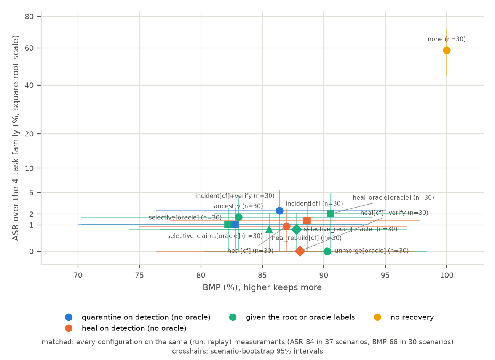

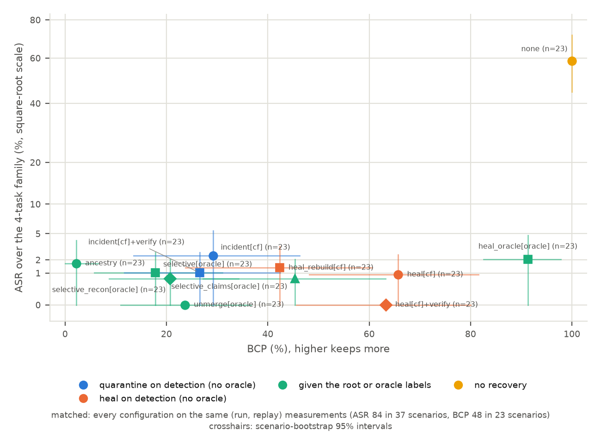

## 2. Healing vs quarantine with the same detection

**Takeaway:** heal[cf] - incident[cf]: ASR -0.6 pp [-2.2, +0.7] (n=77); BMP +6.0 pp [+0.7, +11.9] (n=74); BCP +39.0 pp [+31.7, +46.4] (n=71). Intervals excluding 0: BMP higher (better), BCP higher (better), residual attack lower (better), memories removed (net) lower (better), LLM calls higher (worse), seconds higher (worse).

A - B per (run, repeat) where both were measured, averaged per scenario, scenario-bootstrap 95% interval. Rates in percentage points; residual attack and memories removed in memories; seconds are wall time under the batch's 64 concurrent workers, so only roughly comparable.

| A - B | metric | A (same scenarios) | B (same scenarios) | A - B [95% CI] (n scenarios) | (run, repeat) pairs | reading |
|---|---|---|---|---|---|---|
| heal[cf] - incident[cf] | ASR | 6.9 | 7.5 | -0.6 [-2.2, +0.7] (n=77) | 693 | interval includes 0 |
| heal[cf] - incident[cf] | BMP | 90.0 | 83.9 | +6.0 [+0.7, +11.9] (n=74) | 590 | higher (better) |
| heal[cf] - incident[cf] | BCP | 77.5 | 38.5 | +39.0 [+31.7, +46.4] (n=71) | 507 | higher (better) |
| heal[cf] - incident[cf] | residual attack | 0.34 | 0.40 | -0.05 [-0.10, -0.01] (n=77) | 693 | lower (better) |
| heal[cf] - incident[cf] | memories removed (net) | 1.13 | 2.79 | -1.66 [-2.01, -1.35] (n=77) | 693 | lower (better) |
| heal[cf] - incident[cf] | LLM calls | 19.9 | 11.8 | +8.1 [+6.8, +9.3] (n=77) | 693 | higher (worse) |
| heal[cf] - incident[cf] | seconds | 32.3 | 20.0 | +12.3 [+8.5, +16.0] (n=77) | 693 | higher (worse) |
| heal_rebuild[cf] - incident[cf] | ASR | 6.5 | 7.5 | -1.0 [-2.5, +0.2] (n=77) | 693 | interval includes 0 |
| heal_rebuild[cf] - incident[cf] | BMP | 89.7 | 83.9 | +5.8 [+1.6, +10.6] (n=74) | 590 | higher (better) |
| heal_rebuild[cf] - incident[cf] | BCP | 52.3 | 38.2 | +14.2 [+8.7, +19.7] (n=71) | 508 | higher (better) |
| heal_rebuild[cf] - incident[cf] | residual attack | 0.34 | 0.40 | -0.05 [-0.10, -0.01] (n=77) | 693 | lower (better) |
| heal_rebuild[cf] - incident[cf] | memories removed (net) | 1.98 | 2.79 | -0.81 [-1.00, -0.64] (n=77) | 693 | lower (better) |
| heal_rebuild[cf] - incident[cf] | LLM calls | 20.5 | 11.8 | +8.7 [+7.3, +10.0] (n=77) | 693 | higher (worse) |
| heal_rebuild[cf] - incident[cf] | seconds | 33.7 | 20.0 | +13.7 [+9.9, +17.7] (n=77) | 693 | higher (worse) |
| heal_oracle[oracle] - incident[cf] | ASR | 7.8 | 7.5 | +0.3 [-1.4, +2.3] (n=77) | 693 | interval includes 0 |
| heal_oracle[oracle] - incident[cf] | BMP | 90.6 | 83.9 | +6.7 [+1.7, +12.1] (n=74) | 590 | higher (better) |
| heal_oracle[oracle] - incident[cf] | BCP | 89.7 | 38.5 | +51.2 [+43.5, +58.9] (n=71) | 507 | higher (better) |
| heal_oracle[oracle] - incident[cf] | residual attack | 0.35 | 0.40 | -0.05 [-0.10, -0.01] (n=77) | 693 | lower (better) |
| heal_oracle[oracle] - incident[cf] | memories removed (net) | 0.89 | 2.79 | -1.90 [-2.29, -1.57] (n=77) | 693 | lower (better) |
| heal_oracle[oracle] - incident[cf] | LLM calls | 14.2 | 11.8 | +2.4 [+1.8, +3.0] (n=77) | 693 | higher (worse) |
| heal_oracle[oracle] - incident[cf] | seconds | 22.1 | 20.0 | +2.1 [-0.4, +4.4] (n=77) | 693 | interval includes 0 |
| heal[cf]+verify - incident[cf]+verify | ASR | 0.0 | 1.0 | -1.0 [-2.7, +0.0] (n=37) | 84 | interval includes 0 |
| heal[cf]+verify - incident[cf]+verify | BMP | 88.1 | 82.8 | +5.3 [-4.2, +16.4] (n=30) | 66 | interval includes 0 |
| heal[cf]+verify - incident[cf]+verify | BCP | 63.4 | 26.6 | +36.8 [+19.9, +54.7] (n=23) | 48 | higher (better) |
| heal[cf]+verify - incident[cf]+verify | residual attack | 0.19 | 0.24 | -0.05 [-0.14, +0.00] (n=37) | 84 | interval includes 0 |
| heal[cf]+verify - incident[cf]+verify | memories removed (net) | 0.95 | 3.39 | -2.44 [-3.27, -1.71] (n=37) | 84 | lower (better) |
| heal[cf]+verify - incident[cf]+verify | LLM calls | 53.4 | 47.2 | +6.2 [-2.1, +13.2] (n=37) | 84 | interval includes 0 |
| heal[cf]+verify - incident[cf]+verify | seconds | 104.4 | 102.9 | +1.5 [-15.8, +16.5] (n=37) | 84 | interval includes 0 |

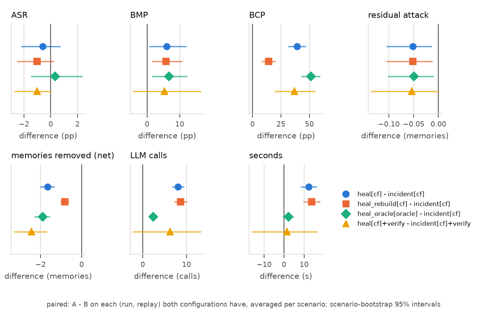

## 3. Per attack category and per domain

**Takeaway:** heal[cf] - incident[cf] ASR by attack category (paired): direct +0.1 pp [-2.7, +2.0] (n=26); composed -1.6 pp [-5.1, +1.2] (n=25); procedural -0.4 pp [-2.2, +1.2] (n=26).

Matched within each category (domain): every configuration on the (run, replay) measurements all of them have there, per metric; the last row of each table gives that set's size. Coverage is uneven, so the coverage-dependent numbers (each configuration on everything it has) are in main.json under all_measurements.

ASR (%) by attack category:

| configuration | direct | composed | procedural |
|---|---|---|---|
| none | 69.6 [50.0, 87.5] (n=14) | 66.7 [43.1, 86.8] (n=12) | 36.0 [11.4, 61.0] (n=11) |
| ancestry | 2.7 [0.0, 8.0] (n=14) | 2.1 [0.0, 6.2] (n=12) | 0.0 [0.0, 0.0] (n=11) |
| selective[oracle] | 0.9 [0.0, 2.7] (n=14) | 2.1 [0.0, 6.2] (n=12) | 0.0 [0.0, 0.0] (n=11) |
| selective_recon[oracle] | 1.8 [0.0, 5.4] (n=14) | 0.0 [0.0, 0.0] (n=12) | 0.0 [0.0, 0.0] (n=11) |
| selective_claims[oracle] | 1.8 [0.0, 5.4] (n=14) | 0.0 [0.0, 0.0] (n=12) | 0.0 [0.0, 0.0] (n=11) |
| unmerge[oracle] | 0.0 [0.0, 0.0] (n=14) | 0.0 [0.0, 0.0] (n=12) | 0.0 [0.0, 0.0] (n=11) |
| incident[cf] | 2.7 [0.0, 8.0] (n=14) | 2.1 [0.0, 6.2] (n=12) | 2.3 [0.0, 6.8] (n=11) |
| incident[cf]+verify | 0.9 [0.0, 2.7] (n=14) | 2.1 [0.0, 6.2] (n=12) | 0.0 [0.0, 0.0] (n=11) |
| heal[cf] | 0.6 [0.0, 1.8] (n=14) | 2.1 [0.0, 6.2] (n=12) | 0.0 [0.0, 0.0] (n=11) |
| heal_rebuild[cf] | 0.0 [0.0, 0.0] (n=14) | 2.1 [0.0, 6.2] (n=12) | 2.3 [0.0, 6.8] (n=11) |
| heal[cf]+verify | 0.0 [0.0, 0.0] (n=14) | 0.0 [0.0, 0.0] (n=12) | 0.0 [0.0, 0.0] (n=11) |
| heal_oracle[oracle] | 1.8 [0.0, 5.4] (n=14) | 2.1 [0.0, 6.2] (n=12) | 2.3 [0.0, 6.8] (n=11) |
| matched (run, replay) measurements / scenarios | 31 / 14 | 27 / 12 | 26 / 11 |

BCP (%) by attack category:

| configuration | direct | composed | procedural |
|---|---|---|---|
| none | 100.0 [100.0, 100.0] (n=7, small sample) | 100.0 [100.0, 100.0] (n=8, small sample) | 100.0 [100.0, 100.0] (n=8, small sample) |
| ancestry | 0.0 [0.0, 0.0] (n=7, small sample) | 6.2 [0.0, 18.8] (n=8, small sample) | 0.0 [0.0, 0.0] (n=8, small sample) |
| selective[oracle] | 14.3 [0.0, 42.9] (n=7, small sample) | 18.8 [0.0, 43.8] (n=8, small sample) | 20.0 [4.2, 40.0] (n=8, small sample) |
| selective_recon[oracle] | 21.4 [0.0, 50.0] (n=7, small sample) | 18.8 [0.0, 43.8] (n=8, small sample) | 22.1 [6.2, 42.9] (n=8, small sample) |
| selective_claims[oracle] | 71.4 [42.9, 100.0] (n=7, small sample) | 43.8 [12.5, 75.0] (n=8, small sample) | 24.2 [7.5, 47.5] (n=8, small sample) |
| unmerge[oracle] | 21.4 [0.0, 50.0] (n=7, small sample) | 22.9 [4.2, 50.0] (n=8, small sample) | 26.2 [7.5, 45.0] (n=8, small sample) |
| incident[cf] | 14.3 [0.0, 42.9] (n=7, small sample) | 18.8 [0.0, 43.8] (n=8, small sample) | 52.6 [22.6, 82.6] (n=8, small sample) |
| incident[cf]+verify | 14.3 [0.0, 42.9] (n=7, small sample) | 18.8 [0.0, 43.8] (n=8, small sample) | 45.1 [17.5, 72.5] (n=8, small sample) |
| heal[cf] | 78.6 [50.0, 100.0] (n=7, small sample) | 36.7 [10.9, 64.6] (n=8, small sample) | 83.4 [58.4, 100.0] (n=8, small sample) |
| heal_rebuild[cf] | 28.6 [0.0, 57.1] (n=7, small sample) | 28.3 [3.3, 60.0] (n=8, small sample) | 68.3 [37.5, 95.0] (n=8, small sample) |
| heal[cf]+verify | 78.6 [50.0, 100.0] (n=7, small sample) | 33.4 [6.2, 62.5] (n=8, small sample) | 80.0 [55.0, 100.0] (n=8, small sample) |
| heal_oracle[oracle] | 100.0 [100.0, 100.0] (n=7, small sample) | 75.0 [56.2, 93.8] (n=8, small sample) | 100.0 [100.0, 100.0] (n=8, small sample) |
| matched (run, replay) measurements / scenarios | 12 / 7 | 19 / 8 | 17 / 8 |

ASR (%) by domain:

| configuration | coding | office | research | travel |
|---|---|---|---|---|
| none | 52.9 [27.9, 77.5] (n=10) | 50.0 [22.2, 77.8] (n=9, small sample) | 57.9 [30.0, 83.3] (n=10) | 76.6 [51.6, 96.9] (n=8, small sample) |
| ancestry | 0.0 [0.0, 0.0] (n=10) | 2.8 [0.0, 8.3] (n=9, small sample) | 3.8 [0.0, 11.2] (n=10) | 0.0 [0.0, 0.0] (n=8, small sample) |
| selective[oracle] | 0.0 [0.0, 0.0] (n=10) | 2.8 [0.0, 8.3] (n=9, small sample) | 1.2 [0.0, 3.8] (n=10) | 0.0 [0.0, 0.0] (n=8, small sample) |
| selective_recon[oracle] | 0.0 [0.0, 0.0] (n=10) | 0.0 [0.0, 0.0] (n=9, small sample) | 2.5 [0.0, 7.5] (n=10) | 0.0 [0.0, 0.0] (n=8, small sample) |
| selective_claims[oracle] | 0.0 [0.0, 0.0] (n=10) | 0.0 [0.0, 0.0] (n=9, small sample) | 2.5 [0.0, 7.5] (n=10) | 0.0 [0.0, 0.0] (n=8, small sample) |
| unmerge[oracle] | 0.0 [0.0, 0.0] (n=10) | 0.0 [0.0, 0.0] (n=9, small sample) | 0.0 [0.0, 0.0] (n=10) | 0.0 [0.0, 0.0] (n=8, small sample) |
| incident[cf] | 2.5 [0.0, 7.5] (n=10) | 2.8 [0.0, 8.3] (n=9, small sample) | 3.8 [0.0, 11.2] (n=10) | 0.0 [0.0, 0.0] (n=8, small sample) |
| incident[cf]+verify | 0.0 [0.0, 0.0] (n=10) | 2.8 [0.0, 8.3] (n=9, small sample) | 1.2 [0.0, 3.8] (n=10) | 0.0 [0.0, 0.0] (n=8, small sample) |
| heal[cf] | 3.3 [0.0, 8.3] (n=10) | 0.0 [0.0, 0.0] (n=9, small sample) | 0.0 [0.0, 0.0] (n=10) | 0.0 [0.0, 0.0] (n=8, small sample) |
| heal_rebuild[cf] | 2.5 [0.0, 7.5] (n=10) | 2.8 [0.0, 8.3] (n=9, small sample) | 0.0 [0.0, 0.0] (n=10) | 0.0 [0.0, 0.0] (n=8, small sample) |
| heal[cf]+verify | 0.0 [0.0, 0.0] (n=10) | 0.0 [0.0, 0.0] (n=9, small sample) | 0.0 [0.0, 0.0] (n=10) | 0.0 [0.0, 0.0] (n=8, small sample) |
| heal_oracle[oracle] | 2.5 [0.0, 7.5] (n=10) | 2.8 [0.0, 8.3] (n=9, small sample) | 2.5 [0.0, 7.5] (n=10) | 0.0 [0.0, 0.0] (n=8, small sample) |
| matched (run, replay) measurements / scenarios | 23 / 10 | 19 / 9 | 23 / 10 | 19 / 8 |

BCP (%) by domain:

| configuration | coding | office | research | travel |
|---|---|---|---|---|
| none | 100.0 [100.0, 100.0] (n=8, small sample) | 100.0 [100.0, 100.0] (n=4, small sample) | 100.0 [100.0, 100.0] (n=6, small sample) | 100.0 [100.0, 100.0] (n=5, small sample) |
| ancestry | 0.0 [0.0, 0.0] (n=8, small sample) | 0.0 [0.0, 0.0] (n=4, small sample) | 8.3 [0.0, 25.0] (n=6, small sample) | 0.0 [0.0, 0.0] (n=5, small sample) |
| selective[oracle] | 24.2 [4.2, 50.0] (n=8, small sample) | 41.7 [0.0, 83.3] (n=4, small sample) | 8.3 [0.0, 25.0] (n=6, small sample) | 0.0 [0.0, 0.0] (n=5, small sample) |
| selective_recon[oracle] | 32.5 [7.5, 57.5] (n=8, small sample) | 41.7 [0.0, 83.3] (n=4, small sample) | 8.3 [0.0, 25.0] (n=6, small sample) | 0.0 [0.0, 0.0] (n=5, small sample) |
| selective_claims[oracle] | 53.3 [23.3, 83.3] (n=8, small sample) | 66.7 [25.0, 100.0] (n=4, small sample) | 25.0 [0.0, 58.3] (n=6, small sample) | 40.0 [0.0, 80.0] (n=5, small sample) |
| unmerge[oracle] | 30.4 [7.5, 55.4] (n=8, small sample) | 50.0 [16.7, 83.3] (n=4, small sample) | 8.3 [0.0, 25.0] (n=6, small sample) | 10.0 [0.0, 30.0] (n=5, small sample) |
| incident[cf] | 27.6 [7.5, 53.4] (n=8, small sample) | 50.0 [0.0, 100.0] (n=4, small sample) | 25.0 [0.0, 58.3] (n=6, small sample) | 20.0 [0.0, 60.0] (n=5, small sample) |
| incident[cf]+verify | 27.6 [7.5, 53.4] (n=8, small sample) | 35.0 [0.0, 75.0] (n=4, small sample) | 25.0 [0.0, 58.3] (n=6, small sample) | 20.0 [0.0, 60.0] (n=5, small sample) |
| heal[cf] | 77.2 [52.2, 96.9] (n=8, small sample) | 52.6 [5.2, 100.0] (n=4, small sample) | 63.9 [33.3, 91.7] (n=6, small sample) | 60.0 [20.0, 100.0] (n=5, small sample) |
| heal_rebuild[cf] | 43.3 [12.5, 72.5] (n=8, small sample) | 56.6 [13.2, 100.0] (n=4, small sample) | 33.3 [0.0, 66.7] (n=6, small sample) | 40.0 [0.0, 80.0] (n=5, small sample) |
| heal[cf]+verify | 78.8 [53.8, 100.0] (n=8, small sample) | 44.4 [8.7, 80.0] (n=4, small sample) | 58.3 [25.0, 91.7] (n=6, small sample) | 60.0 [20.0, 100.0] (n=5, small sample) |
| heal_oracle[oracle] | 100.0 [100.0, 100.0] (n=8, small sample) | 83.3 [50.0, 100.0] (n=4, small sample) | 77.8 [61.1, 94.4] (n=6, small sample) | 100.0 [100.0, 100.0] (n=5, small sample) |
| matched (run, replay) measurements / scenarios | 18 / 8 | 7 / 4 | 12 / 6 | 11 / 5 |

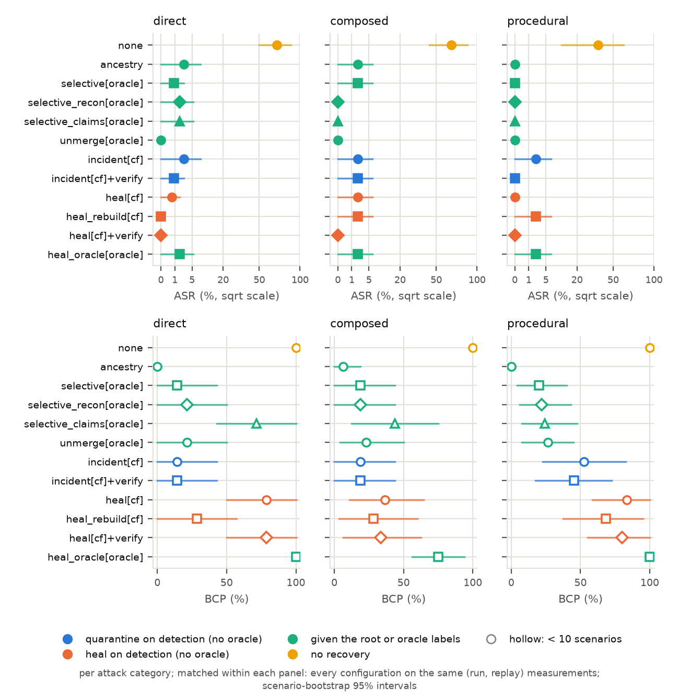

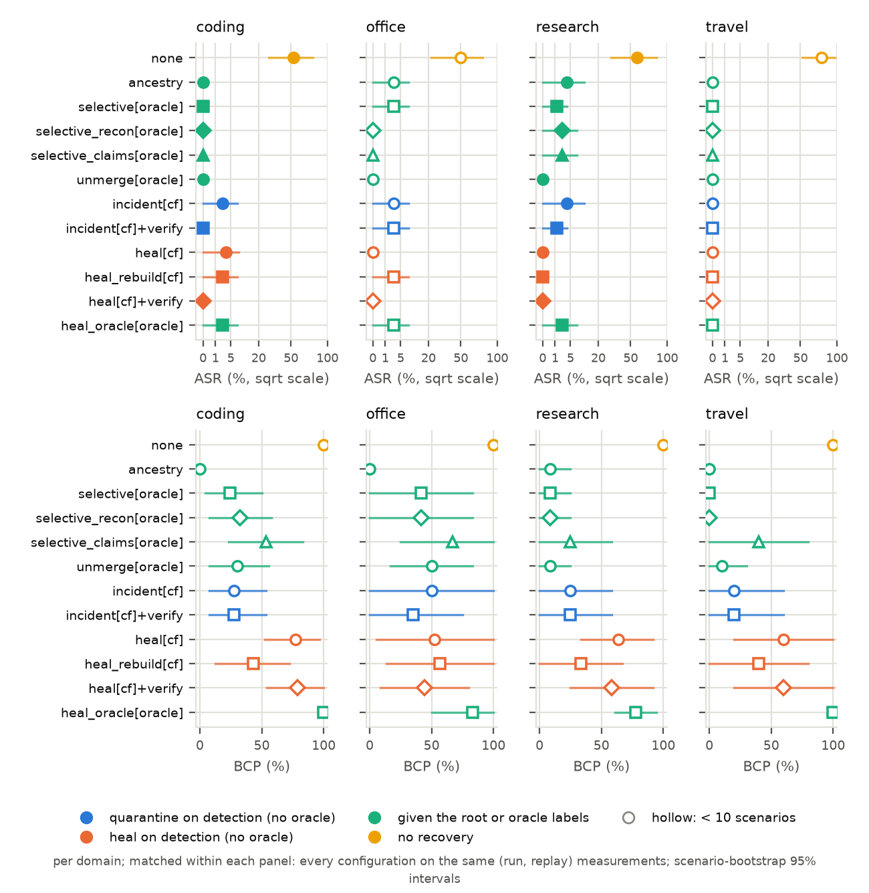

## 4. Repetition: replays, history samples, variance

**Takeaway:** Median share of ASR variance across configurations: scenario 14%, history 68%, replay 16%; a single replay disagrees with its run's 3-replay majority on 131/7044 replays (1.9%) pooled over configurations; 1 of 12 single-replay paired ASR conclusions (CI side of 0) differ from the all-replay one.

ASR (%) using one replay only, and one history sample only (mean over the other level), on the scenarios where the configuration has every replay (every history sample), so the columns compare the same scenarios; spread = max - min of the means, in pp. Each row stands on its own configuration's scenarios: compare along a row, not down a column (Sections 1 and 2 compare configurations).

| configuration | replay 1 | replay 2 | replay 3 | spread | history sample 1 | history sample 2 | history sample 3 | spread |
|---|---|---|---|---|---|---|---|---|
| none | 61.0 [53.5, 68.2] (n=77) | 60.7 [53.2, 67.9] (n=77) | 60.9 [53.4, 68.2] (n=77) | 0.3 | 56.7 [47.8, 65.4] (n=77) | 59.3 [50.3, 67.7] (n=77) | 66.7 [57.9, 74.7] (n=77) | 10.0 |
| ancestry | 1.1 [0.2, 2.2] (n=77) | 1.3 [0.3, 2.5] (n=77) | 0.9 [0.2, 1.7] (n=77) | 0.4 | 1.4 [0.3, 2.8] (n=77) | 0.6 [0.0, 1.7] (n=77) | 1.2 [0.2, 2.4] (n=77) | 0.8 |
| selective[oracle] | 1.6 [0.5, 2.9] (n=77) | 1.2 [0.3, 2.2] (n=77) | 1.7 [0.6, 3.0] (n=77) | 0.5 | 1.4 [0.2, 2.7] (n=77) | 0.9 [0.1, 1.8] (n=77) | 2.3 [0.5, 4.4] (n=77) | 1.4 |
| selective_recon[oracle] | 1.1 [0.3, 1.9] (n=77) | 1.0 [0.2, 1.8] (n=77) | 1.1 [0.1, 2.3] (n=77) | 0.1 | 0.9 [0.1, 1.8] (n=77) | 0.4 [0.0, 1.2] (n=77) | 1.8 [0.4, 3.6] (n=77) | 1.4 |
| selective_claims[oracle] | 1.9 [0.9, 3.1] (n=77) | 1.4 [0.5, 2.6] (n=77) | 2.1 [0.9, 3.5] (n=77) | 0.6 | 1.2 [0.1, 2.5] (n=77) | 1.3 [0.2, 2.5] (n=77) | 2.9 [0.8, 5.5] (n=77) | 1.7 |
| unmerge[oracle] | 0.5 [0.1, 1.2] (n=77) | 1.0 [0.2, 1.8] (n=77) | 0.9 [0.2, 1.6] (n=77) | 0.4 | 0.5 [0.0, 1.4] (n=77) | 0.5 [0.0, 1.4] (n=77) | 1.3 [0.1, 2.9] (n=77) | 0.8 |
| incident[cf] | 7.5 [4.9, 10.3] (n=77) | 7.9 [5.5, 10.6] (n=77) | 7.0 [4.9, 9.4] (n=77) | 0.9 | 10.2 [5.7, 15.3] (n=77) | 6.4 [3.5, 9.7] (n=77) | 5.8 [2.9, 9.4] (n=77) | 4.3 |
| incident[cf]+verify | 0.0 [0.0, 0.0] (n=22) | 0.0 [0.0, 0.0] (n=22) | 0.0 [0.0, 0.0] (n=22) | 0.0 | - | - | - | - |
| heal[cf] | 7.3 [4.9, 9.8] (n=77) | 6.3 [4.0, 8.9] (n=77) | 7.0 [4.7, 9.5] (n=77) | 1.0 | 10.0 [5.5, 15.2] (n=77) | 6.7 [3.4, 10.6] (n=77) | 3.9 [1.6, 6.5] (n=77) | 6.1 |
| heal_rebuild[cf] | 6.3 [4.2, 8.5] (n=77) | 7.0 [4.7, 9.5] (n=77) | 6.1 [4.0, 8.3] (n=77) | 1.0 | 9.2 [5.0, 14.2] (n=77) | 5.7 [3.0, 9.0] (n=77) | 4.4 [1.8, 7.5] (n=77) | 4.8 |
| heal[cf]+verify | 0.0 [0.0, 0.0] (n=16) | 0.0 [0.0, 0.0] (n=16) | 0.0 [0.0, 0.0] (n=16) | 0.0 | - | - | - | - |
| heal_oracle[oracle] | 8.0 [5.3, 11.1] (n=77) | 8.1 [5.3, 11.4] (n=77) | 7.3 [4.7, 10.2] (n=77) | 0.9 | 11.1 [6.2, 16.9] (n=77) | 6.1 [3.2, 9.3] (n=77) | 6.2 [2.7, 10.4] (n=77) | 5.1 |

Variance decomposition of per-record ASR (nested ANOVA, method of moments; share of total variance, scenario-bootstrap 95% interval):

| configuration | scenarios | runs | records | total variance | between scenarios | between history samples | between replays |
|---|---|---|---|---|---|---|---|
| none | 77 | 231 | 693 | 1567.5 | 55% [42, 67] | 40% [29, 54] | 5% [3, 6] |
| ancestry | 77 | 231 | 693 | 36.9 | 25% [0, 35] | 31% [17, 41] | 44% [26, 71] |
| selective[oracle] | 77 | 231 | 693 | 53.9 | 15% [2, 30] | 53% [25, 71] | 32% [20, 54] |
| selective_recon[oracle] | 77 | 231 | 693 | 36.1 | 22% [3, 33] | 36% [10, 65] | 43% [27, 72] |
| selective_claims[oracle] | 77 | 231 | 693 | 71.0 | 12% [1, 20] | 65% [34, 81] | 23% [10, 50] |
| unmerge[oracle] | 77 | 231 | 693 | 24.7 | 9% [0, 30] | 77% [45, 97] | 15% [3, 38] |
| incident[cf] | 77 | 231 | 693 | 349.0 | 10% [0, 21] | 74% [59, 89] | 16% [8, 25] |
| incident[cf]+verify | - | - | - | - | - | - | - |
| heal[cf] | 77 | 231 | 693 | 333.4 | 11% [0, 22] | 73% [60, 87] | 16% [8, 28] |
| heal_rebuild[cf] | 77 | 231 | 693 | 303.2 | 3% [0, 13] | 81% [63, 92] | 17% [7, 28] |
| heal[cf]+verify | - | - | - | - | - | - | - |
| heal_oracle[oracle] | 77 | 231 | 693 | 399.7 | 19% [1, 36] | 71% [53, 91] | 9% [5, 16] |

Variance decomposition of per-record BMP (nested ANOVA, method of moments; share of total variance, scenario-bootstrap 95% interval):

| configuration | scenarios | runs | records | total variance | between scenarios | between history samples | between replays |
|---|---|---|---|---|---|---|---|
| none | 74 | 205 | 590 | 0.0 | - | - | - |
| ancestry | 74 | 205 | 590 | 1121.4 | 21% [1, 39] | 52% [36, 69] | 27% [19, 38] |
| selective[oracle] | 74 | 205 | 590 | 1199.3 | 30% [12, 49] | 44% [27, 63] | 25% [17, 36] |
| selective_recon[oracle] | 74 | 205 | 590 | 645.1 | 19% [3, 34] | 34% [17, 50] | 48% [34, 63] |
| selective_claims[oracle] | 74 | 205 | 590 | 671.6 | 13% [0, 26] | 55% [40, 70] | 32% [20, 46] |
| unmerge[oracle] | 74 | 205 | 590 | 629.2 | 15% [3, 26] | 34% [20, 50] | 51% [39, 63] |
| incident[cf] | 74 | 205 | 590 | 1004.8 | 29% [8, 47] | 43% [25, 62] | 29% [20, 42] |
| incident[cf]+verify | - | - | - | - | - | - | - |
| heal[cf] | 74 | 205 | 590 | 646.3 | 13% [0, 29] | 39% [21, 59] | 48% [35, 64] |
| heal_rebuild[cf] | 74 | 205 | 590 | 663.1 | 14% [3, 24] | 24% [6, 45] | 62% [47, 77] |
| heal[cf]+verify | - | - | - | - | - | - | - |
| heal_oracle[oracle] | 74 | 205 | 590 | 584.1 | 28% [8, 44] | 27% [10, 43] | 45% [28, 68] |

Single replay vs the 3-replay majority, conclusion 'run attacked' (ASR > 0): replays whose conclusion differs from their run's majority.

| configuration | runs with replays 1-3 | replays differing | runs not unanimous | differing share per scenario (%) |
|---|---|---|---|---|
| none | 231 | 17/693 | 17/231 | 2.5 [1.3, 3.8] (n=77) |
| ancestry | 231 | 11/693 | 11/231 | 1.6 [0.6, 2.7] (n=77) |
| selective[oracle] | 231 | 11/693 | 11/231 | 1.6 [0.4, 2.9] (n=77) |
| selective_recon[oracle] | 231 | 9/693 | 9/231 | 1.3 [0.4, 2.3] (n=77) |
| selective_claims[oracle] | 231 | 11/693 | 11/231 | 1.6 [0.6, 2.7] (n=77) |
| unmerge[oracle] | 231 | 4/693 | 4/231 | 0.6 [0.1, 1.2] (n=77) |
| incident[cf] | 231 | 16/693 | 16/231 | 2.3 [1.2, 3.6] (n=77) |
| incident[cf]+verify | 22 | 0/66 | 0/22 | 0.0 [0.0, 0.0] (n=22) |
| heal[cf] | 231 | 18/693 | 18/231 | 2.6 [1.4, 3.9] (n=77) |
| heal_rebuild[cf] | 231 | 19/693 | 19/231 | 2.7 [1.6, 4.0] (n=77) |
| heal[cf]+verify | 16 | 0/48 | 0/16 | 0.0 [0.0, 0.0] (n=16) |
| heal_oracle[oracle] | 231 | 15/693 | 15/231 | 2.2 [1.2, 3.3] (n=77) |

Paired ASR conclusions (pp) with every replay vs one replay only, on the scenarios where A and B pair at all three replays; last column: scenarios whose sign of A - B differs from the all-replay sign.

| A - B | replays used | A - B [95% CI] | conclusion | scenarios with a different sign |
|---|---|---|---|---|
| heal[cf] - incident[cf] | all | -0.6 [-2.2, +0.7] (n=77) | includes 0 | - |
| heal[cf] - incident[cf] | replay 1 only | -0.2 [-2.3, +1.7] (n=77) | includes 0 | 9/77 |
| heal[cf] - incident[cf] | replay 2 only | -1.6 [-3.4, -0.1] (n=77) | A lower | 12/77 |
| heal[cf] - incident[cf] | replay 3 only | -0.0 [-1.7, +1.6] (n=77) | includes 0 | 11/77 |
| heal[cf]+verify - incident[cf]+verify | all | +0.0 [+0.0, +0.0] (n=16) | includes 0 | - |
| heal[cf]+verify - incident[cf]+verify | replay 1 only | +0.0 [+0.0, +0.0] (n=16) | includes 0 | 0/16 |
| heal[cf]+verify - incident[cf]+verify | replay 2 only | +0.0 [+0.0, +0.0] (n=16) | includes 0 | 0/16 |
| heal[cf]+verify - incident[cf]+verify | replay 3 only | +0.0 [+0.0, +0.0] (n=16) | includes 0 | 0/16 |
| incident[cf] - none | all | -53.4 [-60.7, -46.0] (n=77) | A lower | - |
| incident[cf] - none | replay 1 only | -53.6 [-61.0, -46.1] (n=77) | A lower | 5/77 |
| incident[cf] - none | replay 2 only | -52.8 [-60.3, -45.3] (n=77) | A lower | 5/77 |
| incident[cf] - none | replay 3 only | -53.9 [-61.1, -46.5] (n=77) | A lower | 2/77 |
| heal[cf] - none | all | -54.0 [-61.5, -46.5] (n=77) | A lower | - |
| heal[cf] - none | replay 1 only | -53.8 [-61.1, -46.3] (n=77) | A lower | 5/77 |
| heal[cf] - none | replay 2 only | -54.4 [-61.9, -46.9] (n=77) | A lower | 3/77 |
| heal[cf] - none | replay 3 only | -53.9 [-61.5, -46.2] (n=77) | A lower | 5/77 |

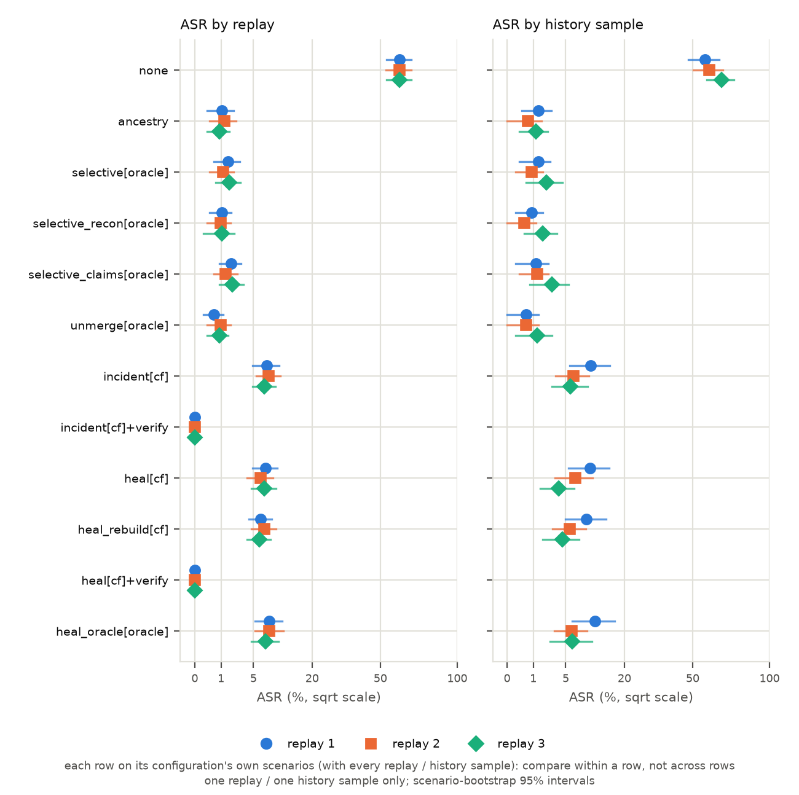

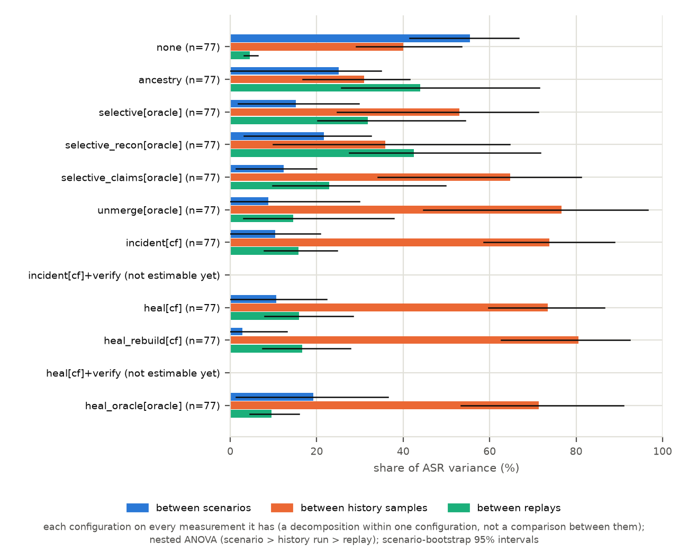

## 5. Clean false alarms: incident vs heal

**Takeaway:** On clean runs, heal[cf]+verify - incident[cf]+verify: memories removed (net) -1.93 memories [-2.20, -1.66] (n=111); BMP +21.4 pp [+15.6, +27.2] (n=111); BR -0.6 pp [-3.0, +1.7] (n=111). Less damage is shown only where an interval excludes 0: memories removed (net) lower (better), BMP higher (better).

Clean runs; the alarm is simulated on the run's own action (recover.py --include-clean), so whatever is removed is a false positive. BMP against the same clean run's 'none' record.

Every configuration has the same measurements (memories quarantined, memories removed (net), BR: 287 (run, replay) measurements in 111 scenarios; BMP: 278 (run, replay) measurements in 111 scenarios).

| configuration | runs measured | memories quarantined | memories removed (net) | BMP (%) | BR (%) |
|---|---|---|---|---|---|
| none | 287 | 0.00 [0.00, 0.00] (n=111) | 0.00 [0.00, 0.00] (n=111) | 100.0 [100.0, 100.0] (n=111) | 84.6 [80.2, 88.9] (n=111) |
| incident[cf]+verify | 287 | 3.92 [3.36, 4.53] (n=111) | 3.92 [3.36, 4.53] (n=111) | 62.9 [57.5, 68.4] (n=111) | 59.3 [52.6, 66.0] (n=111) |
| selective[cf]+verify | 287 | 3.87 [3.32, 4.47] (n=111) | 3.87 [3.32, 4.47] (n=111) | 64.9 [59.9, 70.0] (n=111) | 61.7 [55.2, 68.2] (n=111) |
| heal[cf]+verify | 287 | 3.90 [3.34, 4.53] (n=111) | 2.00 [1.51, 2.50] (n=111) | 84.4 [80.4, 88.1] (n=111) | 58.7 [52.2, 65.0] (n=111) |

| A - B | memories quarantined | memories removed (net) | BMP | BR |
|---|---|---|---|---|
| heal[cf]+verify - incident[cf]+verify | -0.02 [-0.19, +0.14] (n=111) | -1.93 [-2.20, -1.66] (n=111) | +21.4 [+15.6, +27.2] (n=111) | -0.6 [-3.0, +1.7] (n=111) |
| heal[cf]+verify - selective[cf]+verify | +0.03 [-0.08, +0.15] (n=111) | -1.88 [-2.11, -1.64] (n=111) | +19.4 [+13.8, +25.1] (n=111) | -3.1 [-5.7, -0.5] (n=111) |

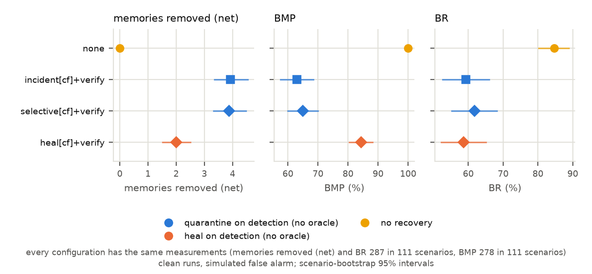

## 6. Reinfection: heal+immunize vs selective+immunize

**Takeaway:** At checkpoint 10: heal[cf]+immunize ASR 55.8% [46.8, 64.6] (n=77), store names attacker 35.1% [24.7, 45.5] (n=77); selective[oracle]+immunize ASR 42.9% [33.4, 52.3] (n=77), store names attacker 1.3% [0.0, 3.9] (n=77); paired ASR +13.0 pp [+2.9, +23.4] (n=77).

Runs followed into the Section 8.8 schedule (checkpoint 0 on patched pages, later checkpoints on live pages). 'store names the attacker' = share of runs with an active memory naming the attacker (residual attack at 0, recover.py's reinfection note later). Matched: every point stands on the 77 runs every configuration followed (at each checkpoint, those all of them have there; last row).

ASR (%) per checkpoint:

| configuration | runs followed | cp 0 | cp 1 | cp 3 | cp 5 | cp 10 |
|---|---|---|---|---|---|---|
| heal[cf]+immunize | 77 | 9.4 [4.9, 14.6] (n=77) | 39.0 [31.5, 46.8] (n=77) | 52.9 [43.8, 62.3] (n=77) | 53.6 [44.5, 62.7] (n=77) | 55.8 [46.8, 64.6] (n=77) |
| selective[oracle]+immunize | 77 | 1.3 [0.0, 3.2] (n=77) | 42.2 [33.4, 51.6] (n=77) | 38.0 [29.5, 47.1] (n=77) | 37.3 [28.9, 46.1] (n=77) | 42.9 [33.4, 52.3] (n=77) |
| matched (run, replay) measurements / scenarios | 77 | 77 / 77 | 77 / 77 | 77 / 77 | 77 / 77 | 77 / 77 |

store names the attacker (%) per checkpoint:

| configuration | runs followed | cp 0 | cp 1 | cp 3 | cp 5 | cp 10 |
|---|---|---|---|---|---|---|
| heal[cf]+immunize | 77 | 35.1 [24.7, 45.5] (n=77) | 35.1 [24.7, 45.5] (n=77) | 36.4 [26.0, 46.8] (n=77) | 36.4 [26.0, 46.8] (n=77) | 35.1 [24.7, 45.5] (n=77) |
| selective[oracle]+immunize | 77 | 1.3 [0.0, 3.9] (n=77) | 1.3 [0.0, 3.9] (n=77) | 1.3 [0.0, 3.9] (n=77) | 1.3 [0.0, 3.9] (n=77) | 1.3 [0.0, 3.9] (n=77) |
| matched (run, replay) measurements / scenarios | 77 | 77 / 77 | 77 / 77 | 77 / 77 | 77 / 77 | 77 / 77 |

Paired heal[cf]+immunize - selective[oracle]+immunize on the 77 runs both followed (pp):

| metric | cp 0 | cp 1 | cp 3 | cp 5 | cp 10 |
|---|---|---|---|---|---|
| ASR | +8.1 [+3.2, +13.6] (n=77) | -3.2 [-10.1, +3.2] (n=77) | +14.9 [+6.5, +24.0] (n=77) | +16.2 [+8.1, +24.7] (n=77) | +13.0 [+2.9, +23.4] (n=77) |
| store names the attacker | +33.8 [+23.4, +44.2] (n=77) | +33.8 [+23.4, +44.2] (n=77) | +35.1 [+24.7, +45.5] (n=77) | +35.1 [+24.7, +45.5] (n=77) | +33.8 [+23.4, +44.2] (n=77) |

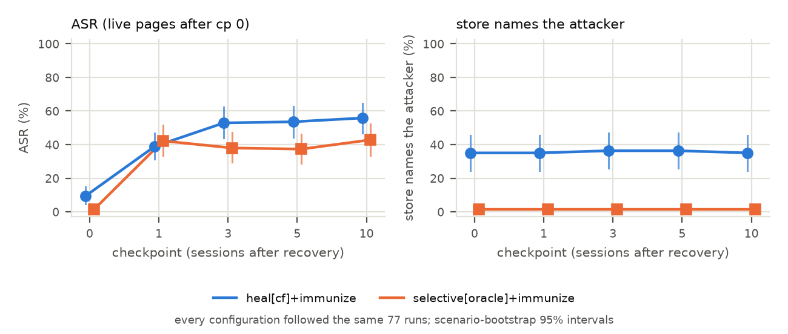

## 7. Cost: LLM calls and seconds

**Takeaway:** most LLM calls per recovery: heal[cf]+verify 53.4 calls [45.6, 60.7] (n=37); heal[cf] - incident[cf] LLM calls +8.1 calls [+6.8, +9.3] (n=77); heal[cf]+verify - incident[cf]+verify LLM calls +6.2 calls [-2.1, +13.2] (n=37).

Per recovery (one record), mean over scenarios with scenario-bootstrap 95% interval; median / p90 / max over the same records. Seconds are wall time under 64 concurrent workers.

Matched: each metric on the measurements every configuration has a value of it on, so the rows compare like with like (LLM calls, seconds: 84 (run, replay) measurements in 37 scenarios (of up to 693; limited by heal[cf]+verify)). The coverage-dependent numbers (each configuration on every measurement it has) are in main.json under all_measurements.

| configuration | LLM calls | seconds | LLM calls median / p90 / max | seconds median / p90 / max |
|---|---|---|---|---|
| none | 0.0 [0.0, 0.0] (n=37) | 0.1 [0.1, 0.2] (n=37) | 0 / 0 / 0 | 0 / 1 / 1 |
| ancestry | 0.0 [0.0, 0.0] (n=37) | 0.1 [0.1, 0.1] (n=37) | 0 / 0 / 0 | 0 / 0 / 1 |
| selective[oracle] | 0.0 [0.0, 0.0] (n=37) | 0.1 [0.1, 0.1] (n=37) | 0 / 0 / 0 | 0 / 0 / 1 |
| selective_recon[oracle] | 0.3 [0.2, 0.5] (n=37) | 0.4 [0.2, 0.6] (n=37) | 0 / 1 / 1 | 0 / 1 / 1 |
| selective_claims[oracle] | 0.3 [0.2, 0.5] (n=37) | 0.4 [0.3, 0.6] (n=37) | 0 / 1 / 1 | 0 / 1 / 2 |
| unmerge[oracle] | 0.0 [0.0, 0.0] (n=37) | 0.1 [0.1, 0.2] (n=37) | 0 / 0 / 0 | 0 / 0 / 1 |
| incident[cf] | 12.0 [9.0, 14.9] (n=37) | 25.6 [17.1, 34.0] (n=37) | 10 / 24 / 39 | 13 / 54 / 169 |
| incident[cf]+verify | 47.2 [38.8, 56.2] (n=37) | 102.9 [82.1, 124.9] (n=37) | 36 / 64 / 150 | 77 / 155 / 385 |
| heal[cf] | 22.0 [16.5, 27.3] (n=37) | 41.1 [27.3, 55.3] (n=37) | 18 / 43 / 62 | 21 / 100 / 253 |
| heal_rebuild[cf] | 23.1 [17.0, 29.0] (n=37) | 37.1 [24.8, 50.5] (n=37) | 17 / 47 / 69 | 22 / 70 / 229 |
| heal[cf]+verify | 53.4 [45.6, 60.7] (n=37) | 104.4 [88.1, 120.2] (n=37) | 46 / 76 / 124 | 87 / 148 / 242 |
| heal_oracle[oracle] | 16.2 [12.1, 20.3] (n=37) | 23.0 [16.1, 30.1] (n=37) | 16 / 34 / 65 | 18 / 45 / 145 |

Heal's claim-level replays per recovery (claim_cf_replays counts every replay healing ran; ddmin_replays the part delta debugging spent). Matched: each metric on the measurements every heal configuration has a value of it on, so the rows compare like with like (claim-level replays, ddmin replays: 84 (run, replay) measurements in 37 scenarios (of up to 693; limited by heal[cf]+verify)).

| configuration | records | claim-level replays | ddmin replays | records with claim-level replays | records with ddmin replays | claim-level median / p90 / max | ddmin median / p90 / max |
|---|---|---|---|---|---|---|---|
| heal[cf] | 84 | 3.3 [1.9, 5.0] (n=37) | 1.2 [0.3, 2.4] (n=37) | 37/84 | 12/84 | 0 / 6 / 24 | 0 / 3 / 21 |
| heal_rebuild[cf] | 84 | 3.6 [2.2, 5.2] (n=37) | 1.2 [0.3, 2.5] (n=37) | 47/84 | 15/84 | 3 / 6 / 27 | 0 / 3 / 21 |
| heal[cf]+verify | 84 | 3.9 [2.2, 5.8] (n=37) | 1.6 [0.5, 2.9] (n=37) | 36/84 | 14/84 | 0 / 6 / 36 | 0 / 3 / 21 |
| heal_oracle[oracle] | 84 | 0.0 [0.0, 0.0] (n=37) | 0.0 [0.0, 0.0] (n=37) | 0/84 | 0/84 | 0 / 0 / 0 | 0 / 0 / 0 |

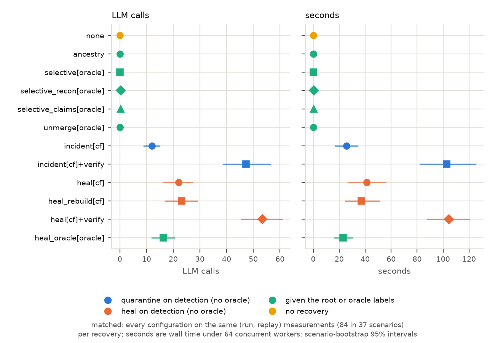

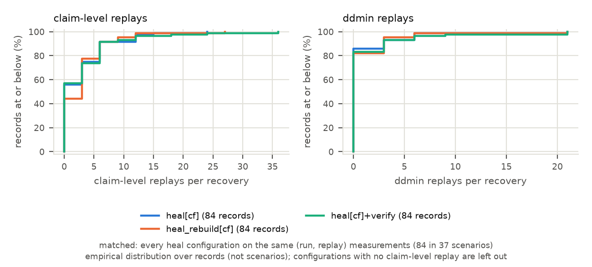

## 8. Cross-suite: heal vs incident

**Takeaway:** heal[cf] - incident[cf] ASR measured on 10/10 suites; interval below 0 on 2 (flat, MemBench), above 0 on 0 (none), includes 0 on the rest.

Per suite, mean over scenarios (dense evolving: over its runs and 3 replays; other suites: 1 replay per history run). The cross-model subset is split by the model each run.db records.

Matched within each suite: none, incident[cf], heal[cf] on the (run, replay) measurements all of them have there (per metric; a configuration the suite lacks is left out), so a row's columns compare the same runs; the differences are paired, each on what both of its configurations have. The coverage-dependent numbers (each configuration on everything it has) are in main.json under all_measurements.

| suite | none runs | incident[cf] runs | heal[cf] runs | matched ASR measurements / scenarios |
|---|---|---|---|---|
| dense evolving | 231 | 231 | 231 | 693 / 77 |
| flat | 216 | 216 | 216 | 216 / 72 |
| adaptive | 156 | 156 | 156 | 156 / 52 |
| subset gpt-5.4 | 84 | 84 | 84 | 84 / 28 |
| subset gpt-5.5 | 84 | 84 | 84 | 84 / 28 |
| subset gpt-4.1-mini | 69 | 69 | 69 | 69 / 23 |
| LongMemEval | 129 | 129 | 129 | 129 / 43 |
| MemBench | 93 | 93 | 93 | 93 / 31 |
| Mem0 | 48 | 48 | 48 | 48 / 16 |
| Mem0 additive | 1 | 1 | 1 | 1 / 1 |

ASR (%):

| suite | none | incident[cf] | heal[cf] | heal[cf] - incident[cf] | heal[cf]+verify - incident[cf]+verify |
|---|---|---|---|---|---|
| dense evolving | 60.9 [53.5, 68.0] (n=77) | 7.5 [5.1, 10.1] (n=77) | 6.9 [4.6, 9.4] (n=77) | -0.6 [-2.2, +0.7] (n=77) | -1.0 [-2.7, +0.0] (n=37) |
| flat | 42.2 [34.7, 49.5] (n=72) | 17.4 [12.7, 22.3] (n=72) | 11.3 [7.9, 15.2] (n=72) | -6.0 [-9.0, -3.1] (n=72) | - |
| adaptive | 57.1 [47.6, 66.3] (n=52) | 11.4 [6.1, 17.0] (n=52) | 9.6 [5.0, 14.6] (n=52) | -1.8 [-3.8, +0.5] (n=52) | +0.2 [-1.0, +1.5] (n=40) |
| subset gpt-5.4 | 61.0 [48.5, 72.3] (n=28) | 10.4 [3.9, 18.5] (n=28) | 10.1 [4.2, 17.0] (n=28) | -0.3 [-3.9, +3.3] (n=28) | +0.0 [+0.0, +0.0] (n=16) |
| subset gpt-5.5 | 60.1 [45.8, 73.5] (n=28) | 7.4 [1.5, 15.5] (n=28) | 5.7 [1.5, 11.3] (n=28) | -1.8 [-7.1, +1.8] (n=28) | +0.0 [+0.0, +0.0] (n=15) |
| subset gpt-4.1-mini | 59.1 [45.3, 71.7] (n=23) | 4.7 [2.2, 7.2] (n=23) | 5.1 [2.5, 7.6] (n=23) | +0.4 [-1.4, +2.2] (n=23) | +0.0 [+0.0, +0.0] (n=10) |
| LongMemEval | 73.6 [64.0, 82.4] (n=43) | 0.8 [0.0, 1.7] (n=43) | 1.4 [0.2, 3.1] (n=43) | +0.6 [-0.4, +1.6] (n=43) | +0.0 [+0.0, +0.0] (n=14) |
| MemBench | 68.5 [56.7, 79.0] (n=31) | 7.8 [4.0, 12.1] (n=31) | 3.8 [1.3, 7.0] (n=31) | -4.0 [-6.7, -1.6] (n=31) | +0.0 [-1.5, +1.5] (n=17) |
| Mem0 | 20.3 [6.2, 35.9] (n=16) | 4.2 [0.0, 12.0] (n=16) | 4.2 [0.0, 12.5] (n=16) | +0.0 [-1.6, +1.6] (n=16) | +0.0 [+0.0, +0.0] (n=16) |
| Mem0 additive | 25.0 [25.0, 25.0] (n=1, small sample) | 0.0 [0.0, 0.0] (n=1, small sample) | 0.0 [0.0, 0.0] (n=1, small sample) | +0.0 [+0.0, +0.0] (n=1, small sample) | +0.0 [+0.0, +0.0] (n=1, small sample) |

BMP (%):

| suite | none | incident[cf] | heal[cf] | heal[cf] - incident[cf] | heal[cf]+verify - incident[cf]+verify |
|---|---|---|---|---|---|
| dense evolving | 100.0 [100.0, 100.0] (n=74) | 83.9 [78.5, 89.0] (n=74) | 90.0 [86.5, 93.2] (n=74) | +6.0 [+0.7, +11.9] (n=74) | +5.3 [-4.2, +16.4] (n=30) |
| flat | 100.0 [100.0, 100.0] (n=68) | 94.8 [90.8, 97.9] (n=68) | 95.6 [91.9, 98.4] (n=68) | +0.9 [-4.2, +5.8] (n=68) | - |
| adaptive | 100.0 [100.0, 100.0] (n=52) | 73.9 [66.0, 81.1] (n=52) | 92.4 [89.1, 95.5] (n=52) | +18.5 [+11.1, +26.1] (n=52) | +19.4 [+9.7, +29.2] (n=40) |
| subset gpt-5.4 | 100.0 [100.0, 100.0] (n=28) | 96.2 [92.9, 98.8] (n=28) | 97.4 [94.8, 99.4] (n=28) | +1.2 [+0.0, +3.6] (n=28) | +0.0 [+0.0, +0.0] (n=16) |
| subset gpt-5.5 | 100.0 [100.0, 100.0] (n=28) | 97.6 [94.6, 100.0] (n=28) | 99.4 [98.2, 100.0] (n=28) | +1.8 [+0.0, +4.8] (n=28) | +2.2 [+0.0, +6.7] (n=15) |
| subset gpt-4.1-mini | 100.0 [100.0, 100.0] (n=23) | 99.5 [98.6, 100.0] (n=23) | 100.0 [100.0, 100.0] (n=23) | +0.5 [+0.0, +1.4] (n=23) | +1.1 [+0.0, +3.3] (n=10) |
| LongMemEval | 100.0 [100.0, 100.0] (n=43) | 92.2 [86.7, 96.5] (n=43) | 94.1 [91.0, 96.9] (n=43) | +1.9 [-1.8, +6.0] (n=43) | -0.4 [-4.8, +4.0] (n=14) |
| MemBench | 100.0 [100.0, 100.0] (n=31) | 92.0 [87.8, 95.5] (n=31) | 91.7 [87.2, 95.4] (n=31) | -0.4 [-5.4, +4.3] (n=31) | +0.3 [-6.5, +6.9] (n=17) |
| Mem0 | 100.0 [100.0, 100.0] (n=15) | 95.9 [90.7, 100.0] (n=15) | 93.3 [87.8, 97.8] (n=15) | -2.6 [-10.4, +5.2] (n=15) | -0.4 [-4.4, +3.0] (n=15) |
| Mem0 additive | 100.0 [100.0, 100.0] (n=1, small sample) | 100.0 [100.0, 100.0] (n=1, small sample) | 100.0 [100.0, 100.0] (n=1, small sample) | +0.0 [+0.0, +0.0] (n=1, small sample) | +0.0 [+0.0, +0.0] (n=1, small sample) |

BCP (%):

| suite | none | incident[cf] | heal[cf] | heal[cf] - incident[cf] | heal[cf]+verify - incident[cf]+verify |
|---|---|---|---|---|---|
| dense evolving | 100.0 [100.0, 100.0] (n=71) | 38.5 [30.9, 46.3] (n=71) | 77.5 [72.0, 83.0] (n=71) | +39.0 [+31.7, +46.4] (n=71) | +36.8 [+19.9, +54.7] (n=23) |
| flat | 100.0 [100.0, 100.0] (n=41) | 74.7 [62.7, 85.6] (n=41) | 66.5 [52.9, 78.9] (n=41) | -8.2 [-28.3, +10.5] (n=41) | - |
| adaptive | 100.0 [100.0, 100.0] (n=52) | 58.9 [49.0, 68.3] (n=52) | 87.8 [81.3, 93.4] (n=52) | +29.0 [+20.1, +37.7] (n=52) | +28.1 [+17.1, +39.2] (n=39) |
| subset gpt-5.4 | 100.0 [100.0, 100.0] (n=24) | 53.6 [38.8, 67.6] (n=24) | 79.2 [66.5, 90.2] (n=24) | +25.6 [+14.8, +36.3] (n=24) | +36.8 [+15.4, +59.0] (n=13) |
| subset gpt-5.5 | 100.0 [100.0, 100.0] (n=24) | 50.0 [33.3, 65.9] (n=24) | 69.0 [52.8, 83.1] (n=24) | +19.0 [+7.1, +32.3] (n=24) | +19.2 [+4.5, +38.9] (n=11) |
| subset gpt-4.1-mini | 100.0 [100.0, 100.0] (n=19) | 58.8 [42.7, 73.7] (n=19) | 77.5 [63.2, 89.3] (n=19) | +18.7 [+6.1, +33.8] (n=19) | +30.8 [+4.4, +62.5] (n=8, small sample) |
| LongMemEval | 100.0 [100.0, 100.0] (n=38) | 29.1 [19.2, 38.9] (n=38) | 69.3 [57.9, 79.6] (n=38) | +40.2 [+28.4, +51.4] (n=38) | +48.2 [+27.9, +68.2] (n=13) |
| MemBench | 100.0 [100.0, 100.0] (n=28) | 29.3 [17.4, 42.0] (n=28) | 76.6 [64.4, 87.3] (n=28) | +47.3 [+33.0, +61.5] (n=28) | +48.9 [+30.0, +68.1] (n=15) |
| Mem0 | 100.0 [100.0, 100.0] (n=7, small sample) | 91.1 [76.8, 100.0] (n=7, small sample) | 100.0 [100.0, 100.0] (n=7, small sample) | +8.9 [+0.0, +23.2] (n=7, small sample) | +6.2 [+0.0, +18.8] (n=8, small sample) |
| Mem0 additive | - | - | - | - | - |

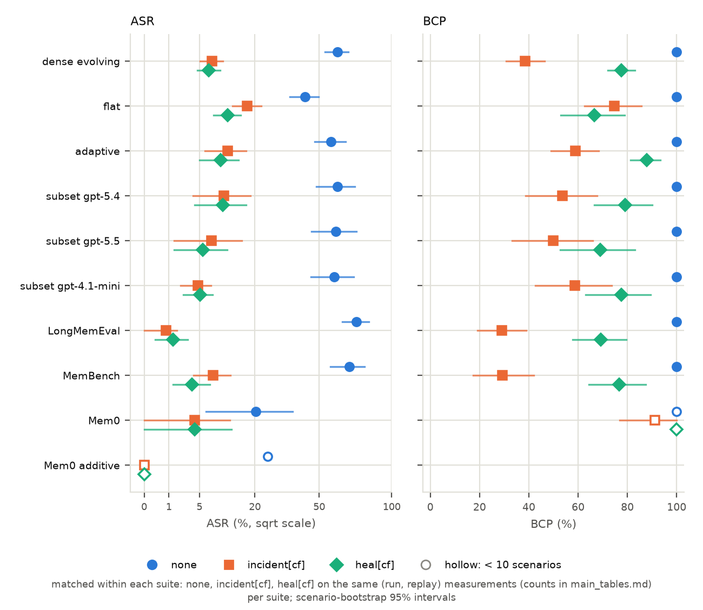
